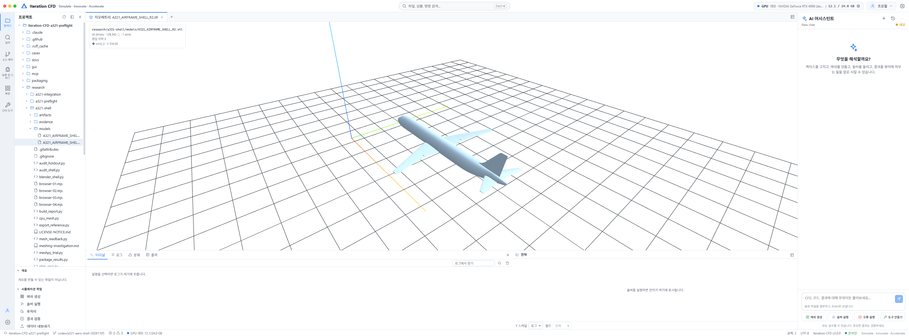
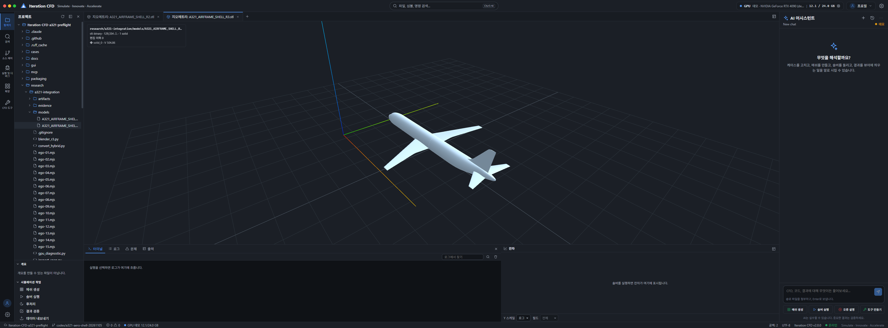
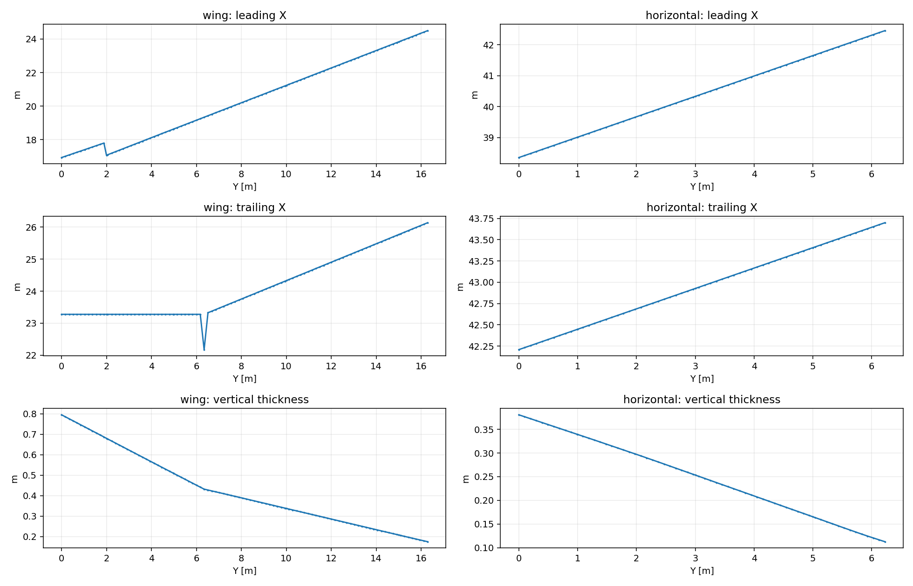
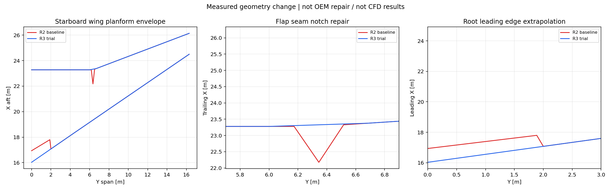

# A321 Studio 반영·날개 홈 수리·경계층/polyMesh·4080 SUPER 진단

2026-11-06. **Studio R2/R3 실제 표시 DONE / 날개 홈 수리 후보 R3 DONE / hybrid polyMesh 생성·재읽기 DONE / 격자 품질 FIX_FIRST / 4080 SUPER 제한 VRAM 진단 PASS / 항공기 해석 NOT_RUN.**

브랜치 `codex/a321-aero-shell-20261105`, 시작점 `6d4bfed29618a5755898dbb9cd8fcd4d4e62656a`. 원본 authored G1B native SHA `1fd3cfd08b1dbf5e5f2fb288caf9846ad149ff8839a37cc2e4c2c8074bc1073c`와 R2 파일은 그대로 보존했다. 기존 실패 이력을 덮어쓰지 않는다.

## 1. Ego Lite에서 실제 Studio에 모델을 열었다

기존 main의 설치 변경을 건드리지 않고 연구 workspace 서버를 `http://127.0.0.1:5183`(API8807)으로 띄웠다. 의존성 폴더만 기존 `gui/node_modules`에 junction으로 연결했다. **서버 workspace는 연구 작업트리**이며 R2/R3 STL을 탐색기 클릭으로 열었다. API 응답과 화면 모두 실제 파일을 읽는 경로다. demo/mock은 솔버·AI에만 적용되고 표면 형상 읽기는 실제다. 유료 모델/API를 사용하지 않았다.

STL 파일은 원형 그대로이며 Studio 표시용 reader는 bbox 대각선 1e-6의 용접을 적용해 R2는 190개, R3는 188개의 작은 삼각형을 퇴화면으로 제외한다. **화면의 triangle 수와 파일의 정확 triangle 수가 다른 이유**다. 표시를 위해 원본 파일을 재저장하지 않았다. 화면만 보고 실제 CFD 입력 위상이 검증됐다고 해석하면 안 된다.

R3 응답: HTTP200, 129,334 표시 삼각형, 1solid, volume504.860824m³, openEdges0. 정확 STL은 129,522삼각형이며 별도 exact-coordinate/vertex-link 검사를 사용했다. `evidence/studio-r2.json`, `studio-r3.json` 참조. 상단 RTX4090 24GB는 **demo 표시**이며 실제 4080SUPER 상태가 아니다.

## 2. “날개 홈”은 실제 R2 형상 결함이었다

R2 span 단면의 leading/trailing X를 검사했다. Y≈6.34475m에서 flap seam 구간이 빠지며 뒤쪽 경계가 크게 안으로 들어갔다. trailing X의 최소 dx/dy=-6.43006, 인접 기울기 변화 약13.153이다. 영상의 smooth shading만의 문제는 아니다. 원본 장치 간 틈을 station 단면 envelope가 승계한 것으로 해석하며, 본 연구의 연속 외형 의도에는 맞지 않는다.

R3는 아래 **명시적 연구 형상 변경**을 적용했다.

- Y6.10~6.60m: 양옆 정상 station 사이의 전체 단면을 보간해 flap seam notch를 연결.
- Y0~2.35m: Y2.35~3.8m의 단면을 선형 외삽해 root leading-edge step을 제거.
- 우현 수정 후 좌현 미러, 기존 동체·수평/수직미익과 CPU Boolean union. R2/원본 보존.

**최대 ring 이동은 약1.15849m**다. 큰 이동이므로 “작은 수리”, “실기 정확도 개선”이라고 부르지 않는다. 무슬롯/연속 날개 가정으로 바뀐 별도 후보이며 root와 장치 접합의 OEM 충실도는 HOLD다. 기존 생략(엔진/파일런/기어/샤클렛/장치 틈/내부)도 유지한다.

홈 검출 테스트는 R2에서 `slope.min=-6.43006`으로 실패한 뒤 R3에서 통과했다. 조건은 이 연구의 선택한 연속 외형에만 해당하며 모든 항공기 뒷전은 단조여야 한다는 보편 규칙이 아니다. `test_span_repair.py`, `evidence/reconstruction-r3.json`.

R3 정확 STL: 129,522삼각형, 64,763정점, closed/winding true, 정점link 실패0, kernel NoError, 연결성분1, 체적504.860824m³. 독립 Blender 새 프로세스에서 재열고 STL을 재출력해 SHA 동일(`2c0111c3bafd34b49b506325e52d13045f997aeaced11236f45b744f08abe745`). 전체 triangle-pair 자기교차와 실기 형상 대조는 미완료다.

## 3. 얇은 셀과 경계층 개선 시도

| 시도 | 실제 결과 | 판정 |
|---|---|---|
| pyacvd 12k 표면 재분할 | 폐합되지 않음 | 거부, 체적격자에 미사용 |
| closed 단순화 표면 + 일정 두께 normal extrusion | TetGen runtime3 | 실패 기록 보존 |
| 국소 edge 길이로 줄인 extrusion | TetGen runtime3 | 실패 기록 보존 |
| R3 원 연결 구조 유지 + 더 작은 adaptive extrusion | 5층 prism+외부 tet 생성 | 품질 검사 진행, 수용 실패 |
| pyacvd30k+subdivide | 경계38/비다양체22 등 결함(소형 cap2 추가 후에도 불합격) | 거부 |

최종 진단 후보 `artifacts/hybrid-r5/hybrid.npz`: **647,610 prism + 213,555 tet = 861,165셀**, 388,964점, 바깥 각 면128삼각형(이전2개보다 증가). 외부 크기는 X[-45,135],Y[-65,65],Z[-45,55]m이며 영역 독립성이 검증된 크기가 아니다. 5층 높이의 nominal 배열은 0,1,2.3,3.99,6.187,9.0431mm지만, 각 정점에서 최소 edge의0.002배 이내로 전체 stack을 제한했다.

이 제한은 sharp/Boolean 작은 삼각형의 교차를 피하기 위한 시험이며 **층 붕괴를 허용했다는 단점**이 있다. 실제 첫층 최소2.32nm·중앙13.90µm·최대40.34µm, 전체 stack 중앙0.126mm. nominal 높이를 전부 얻은 면적0%, 8층 확보율0%. 단순히 y+ 추정≤1 면적이94.47%여도 이것은 충분한 경계층 포착을 의미하지 않는다. 실제 유동 y+는 계산하지 않았다.

### polyMesh 변환과 품질

polyMesh 5파일(points/faces/owner/neighbour/boundary)을 생성했고, repository writer와 별도 memory-bounded reader로 읽었다. owner<neighbour, 내부면 정렬, 7개 patch 연속 배치를 구성한다. 인접 prism-tet 인터페이스는 원래 외피 삼각형129,522개가 tetra boundary와 공유되는지 테스트했다.

`evidence/polyMesh-readback-contract.json`은 저장된 모든 face-cell incidence를 입력 tet/prism에서 재구성한 연결과 대조하고, boundary 이름·타입·시작/개수·예상 patch 수량·완전한 연속 범위·바깥 6면 좌표·원래 aircraft wall 삼각형의 정확한 집합을 검사한 별도 근거다. 변환 무손실 검사가 성공해도 품질 실패를 통과시키지 않는다.

| 검사 | 값 |
|---|---:|
| faces / internal | 2,111,280 / 1,980,990 |
| 점 exact readback | 일치 |
| 유체 연결성분 | 1 |
| nonpositive cell volume | 0 (face-based 적분) |
| 최소 tet / prism 체적 | 1.137e-13 / 1.941e-17 m³ |
| 최대 비직교 | **90.8168°** |
| 비직교>70° 면 | **374,933** |
| 최대 상대 폐합오차 | **3.34156** |
| 최대 절대 면벡터 폐합 | 2.4071e-7 m² |
| 프리즘 6점 Jacobian 표본 부호전환 | **20셀** |
| 전체 체적 | 2,339,495.139175644m³ |
| 판정 | **FIX_FIRST** |

**양 체적만으로 충분하지 않다.** 20프리즘은 6점 표본에서 부호가 바뀌고 상대 폐합·비직교 기준도 실패했다. 국소 normal extrusion을 이용한 이 trial은 공력용 격자로 수용하지 않는다. 이 모델로 항공기 유동 해석을 실행하지 않았다. 공식 ofgpu `-check`도 실행 파일이 없어 미실행이며 Python 진단을 공식 게이트 PASS로 표시하지 않는다.

## 4. Studio polyMesh 로딩

Ego Lite의 같은 Studio에서 `/api/datasets/open`으로 해당 case를 요청했고, 후속 GET이 `source=polymesh`, `geometryFidelity=exact`, cellCount861165, pointCount388964, patch7개를 반환했다. **format reader 로딩 확인**이며 품질/수렴 승인과 다르다. fields/times는 빈 배열이다. 비정렬 polyMesh이므로 현재 Studio는 slices/isosurfaces/streamlines가 불가하다는 경고를 반환한다. 형상 표시·reader 성공을 CFD 결과 보유로 혼동하지 않는다.

## 5. RTX4080 SUPER 메모리 진단

사용자의 GPU 테스트 승인에 따라 UUID `GPU-2147afeb-b9fc-c7f5-398b-d5d00a3a5a90`만 CUDA에 노출해 driver 논리장치0을 선택했다. 장치명 RTX4080SUPER 확인. 1GiB scratch를 할당하고 64MiB 정수 패턴을 host→device→host 복사하여 exact equality를 확인한 뒤 해제했다. context도 해제했다.

진단 context 안의 free memory 전/후는 **14.70996GiB로 동일**, total 약15.99GiB. 장치 메모리 접근·회수 PASS다. 모든1GiB를 검사한 것이 아니며, arithmetic kernel/부하/열·안정성/최대 모델 VRAM 측정이 아니다. 다른 프로세스를 종료하지 않았다. nvidia-smi는 시각마다 다른 작업 때문에 여유가 달랐다.

**ofgpu probe·CUDA solver·항공기 본해석·검증 suite 미실행.** 현재 로컬 CUDA Toolkit12.6, 문서 요구13.x, solver binary 없음. future build는 `OFGPU_CUDA_ARCH=89`, UUID 선택 필요. VRAM 접근 성공을 해당 솔버 호환성·861k mesh 메모리 수용으로 확대하지 않는다.

## 6. 다음 순서와 중단 이유

1. R3 root/장치 보간의 큰 형상 변경을 검토하고 후보 채택 기준을 정한다.
2. 폐합과 곡률/앞전/뒷전을 함께 보존하는 표면 재메시를 확보한다. 현 clustering 2종은 불합격.
3. clearance·collision·Jacobian 기반의 경계층 알고리즘 또는 안정된 CPU prism mesher로 재생성한다. normal extrusion+edge 제한으로는 충분하지 않았다.
4. sliver·비직교·폐합·층두께 포착·boundary mapping을 모두 통과한 뒤 polyMesh 독립 게이트를 다시 실행한다.
5. solver build/runtime를 준비하고 공식 mesh gate·소형 GPU 기준해를 확인한다.
6. 그 후에만 실제 짧은 항공기 예비 계산을 별도 수행한다. 현재 항공기 계산은 **STOP**.

이번에 요청한 항목 중 “얇은 셀/경계층을 공력용 기준으로 개선 완료”는 달성하지 못했다. 다만 실제 문제 위치, R3 후보, hybrid/polyMesh 변환, 정량 실패 근거, Studio reader, GPU 메모리 진단을 재현 가능한 상태로 남겼다. 무의미한 green 판정을 만들기 위해 gate를 낮추지 않았다.

NASA 절차/V&V 지침은 이전 `../a321-shell/README_KO.md`와 원문 JSON에 연결한다. 모델링·메시·코드 verification·실험 validation·GPU 하드웨어 진단은 서로 다른 증거다.
