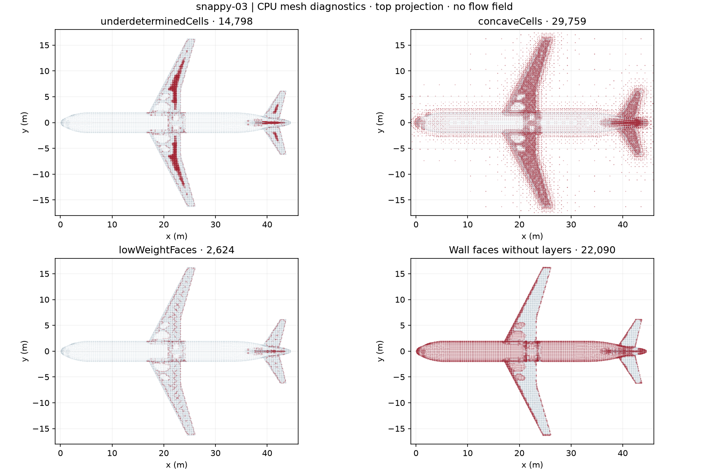
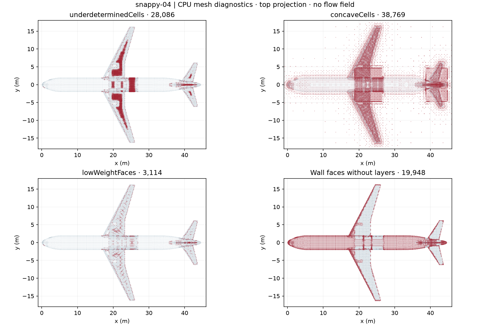
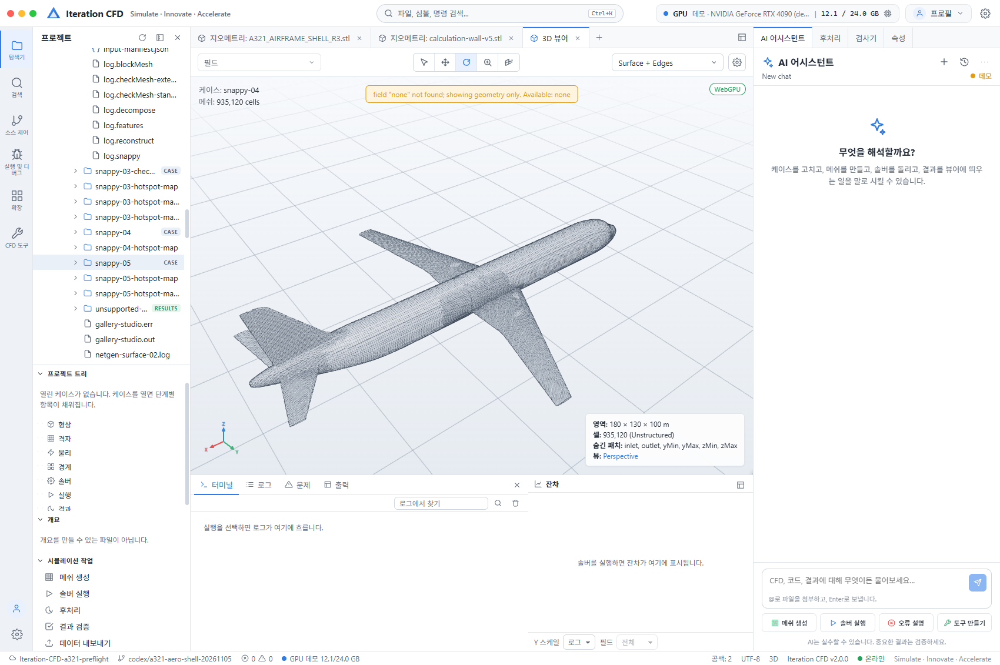
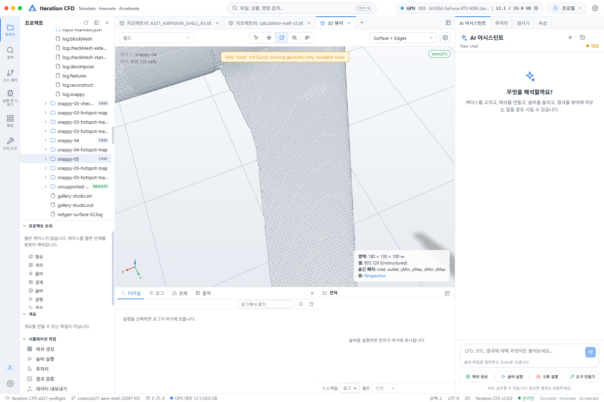

# A321 실패 위치 지도와 CPU 개선 재검사

**2026-11-07 KST · R3 원본 보존 · 다음 연구 후보 snappy-04 · 항공기 GPU 해석 HOLD**

실패 셀·면 ID와 실제 경계층 필드를 좌표로 연결하고, 그 결과로 두 CPU 후보를 생성·재검사했다. **국소 세분화 후보는 층 생성 면적을 33.27%에서 42.60%로 늘렸다.** 비직교·폐합 기준도 유지했다. 셀 수가 2.02배이고 확장 실패는 남아 있으므로 공학적 승인이나 GPU 실행 허가로 바꾸지 않는다. 기준 snappy-03과 R3 STL·BLEND는 보존했다.

## 진행률과 GPU 준비 상태 {#progress}

**기존 8개 체크포인트 중 3개 완료**를 유지한다. 지도화와 개선 실험은 4~6번의 진전이며, 승인된 GPU 메모리 진단은 8번의 일부다. 단계 수를 늘려 완료율을 높이지 않았다.

| 번호 | 단계 | 현재 상태 | 이번 진전과 아직 필요한 것 |
|---:|---|---|---|
| 1 | R3 기준선 보존 | 완료 | 동일 SHA256. 입력 복사본과 원본을 구분하고 원본을 수정하지 않음. |
| 2 | CPU 후보 생성·표시 | 완료 | 03 보존, 새 04·05 생성. Studio에서 04의 935,120셀 확인. |
| 3 | 핵심 수치·기본 검사 | 완료 — 제한적 | 04도 ≤70°와 ≤1e-10, 양수 체적·닫힌 wall·기본 검사 통과. |
| 4 | 계산 형상 적합성 | 부분 | 04의 R3→계산 표면 p95 4.244 mm, 최대 표본 46.309 mm. feature 허용 기준과 전역 거리 보증은 미완료. |
| 5 | 경계층 | 부분 — 개선 | 면적 42.60%, 완전한 8층은 380면. 무층 영역과 실제 첫 높이·벽처리 목표는 남음. |
| 6 | 확장 검사 | 실패 — 지도 확보 | 04도 3개 검사 실패. 절대 개수와 비율을 함께 공개. |
| 7 | 실제 엔진 CPU 인수 | 미실행 | 지정 release 경로에서 실행 바이너리를 확인하지 못함. 물리·경계 조건과 인수 경로 준비 필요. |
| 8 | GPU 실행 전 점검 | 일부 진단 통과 / 보류 | SUPER 고정 UUID로 1 GiB 할당·64 MiB 왕복 통과. 엔진 호환·케이스 최대 VRAM·짧은 솔버 시험은 미검증. |

**GPU 시험의 실제 범위:** 장치 메모리 접근만 실행했다. 산술 CUDA 커널, 항공기 솔버, 부하·열·장시간 안정성 시험은 실행하지 않았다. 테스트 전후 같은 CUDA context의 free memory는 동일했고, 다른 프로세스를 종료하지 않았다. [이번 GPU 기록](evidence/gpu-memory-20261107.json).

## 실패가 어디에 있었나 {#hotspot-map}

아래는 실제 좌표의 위쪽 투영이다. 회색은 계산 벽, 빨간 점은 해당 실패 또는 무층 face 위치다. 압력·응력 분포가 아니다. 셀 집합은 겹치며, 그림은 항공기 주변을 잘라 보여준다. x 범위 밖 concave 셀도 03에 506개, 04에 715개가 있어 전부를 그림 안의 항공기 부위로 해석하지 않는다. 전체 xyz·ID는 로컬 CSV에 보존했다.

<figure><figcaption><strong>기준 snappy-03</strong> 작은 determinant·오목 셀·낮은 가중치·무층 face를 같은 좌표계에서 비교한다.</figcaption></figure>
<figure><figcaption><strong>개선 실험 snappy-04</strong> 해상도를 바꾸면 ID와 셀 수가 달라진다. 같은 ID끼리 비교하지 않는다.</figcaption></figure>

| x 구간 | 기준 03: 작은 determinant / concave / 낮은 가중치 | 기준 무층 면적 | 04 무층 면적 | 해석 |
|---|---:|---:|---:|---|
| 0–12 m | 0 / 1,549 / 0 | 100.00% | 99.87% | 실패 셀 수는 적어도 층 포착은 사실상 없음. |
| 12–20 m | 229 / 2,796 / 261 | 90.55% | 76.71% | 전방 동체 쪽 층 설계가 필요. |
| 20–26 m | 8,303 / 14,355 / 1,456 | 34.40% | **17.92%** | 주익이 있는 종방향 구간. 우선 세분화 대상으로 선정. |
| 26–33 m | 0 / 1,394 / 0 | 100.00% | 90.72% | 몸통 뒷부분의 무층 문제는 여전히 큼. |
| 33–39 m | 124 / 1,186 / 123 | 91.98% | 88.42% | 후방 연결 부위의 층 포착 추가 연구 필요. |
| 39–45 m | 6,142 / 7,973 / 784 | 27.61% | **24.18%** | 꼬리 쪽 두 번째 세분화 대상. |

표는 이름으로 식별한 정확한 구조 패치가 아니라 **겹치지 않는 종방향 구간**이다. 지도는 reconstructed face ID와 processor별 signed one-based 주소를 대조해 만들었다. 모든 wall face가 정확히 한 번 매핑됨을 확인했다. [기준 원장](evidence/snappy-03-hotspots.json), [04 원장](evidence/snappy-04-hotspots.json)에 입력·집합·주소·필드·중심 데이터 SHA를 남겼다. 같은 개수의 다른 ID로 바꾸는 경우도 거부한다.

기준 집합은 원본을 건드리지 않고 **복사한 격자에서 checkMesh를 다시 실행**해 세 집합의 ID 전체가 일치함을 확인했다. [독립 재검사](evidence/snappy-03-check-replay.json). 진단 seals는 생성 후 snapshot이며 최초 실행 전 동결이었다고 주장하지 않는다.

## 우선순위에 따른 개선과 재검사 {#trials}

04는 x=19–26.5 m의 안쪽 주익 부근과 x=38.8–44.6 m 꼬리 뿌리 부근에 level-5 refinement box를 추가했다. 05는 공간 분할을 그대로 두고 명목 첫 층 1→0.75 mm, 최소 총두께 4→2 mm만 낮췄다. 둘 다 기존 8층 요청, R3 입력, 70°/1e-10 판정 기준을 유지했다.

| 항목 | 기준 03 | 국소 세분화 04 | 얇은 층 대조 05 |
|---|---:|---:|---:|
| 셀 수 | 462,113 | 935,120 | 400,549 |
| 독립 최대 비직교 | 66.204° | **66.202°** | **77.969° — 실패** |
| 상대 폐합 | 8.26e-15 | **8.89e-15** | 9.60e-15 |
| 층 생성 면적 | 33.27% | **42.60%** | **8.92%** |
| 완전한 8층 face | 33 | 380 | 0 |
| 작은 determinant 셀 | 14,798 | 28,086 | 861 |
| concave 셀 | 29,759 | 38,769 | 22,204 |
| 낮은 보간 가중치 면 | 2,624 | 3,114 | 1,304 |
| 확장 검사 | 3개 실패 | **3개 실패** | **5개 실패** |
| native 최종 illegal faces | 0 | 0 | 168 |
| 연구 판정 | 기준 보존 | **후속 연구 후보** | 제외 |

04의 determinant 셀 비율은 약 3.20→3.00%, concave 셀 비율은 6.44→4.15%로 낮아졌지만 **절대 실패 개수는 늘었다**. 다른 해상도의 셀 비율만으로 물리적 오류가 줄었다고 증명할 수 없다. 04 선택의 직접 근거는 핵심 기준을 유지하면서 층 면적이 **9.33 percentage points** 늘어난 것이며, 비용은 셀 수 **2.02배**다.

05에서는 face-tet 품질 문제 1면과 낮은 체적 비율 46면도 나왔다. 실패 수가 줄어 보이는 것은 층이 대거 사라진 결과와 함께 읽어야 한다. 더 얇게 만드는 방식은 채택하지 않았다. [후보 비교·판정 원장](evidence/hotspot-comparison.json).

## Ego Lite Studio에서 확인한 후속 모델 {#studio}

<figure><figcaption><strong>935,120셀 후보의 벽면</strong> 바깥 경계 6개를 숨긴 실제 polyMesh 표시다. 내부 셀 전부를 그린 화면은 아니다.</figcaption></figure>
<figure><figcaption><strong>주익 근처 확대</strong> 표면 모서리와 표시용 삼각 분할을 보여 준다. 압력·속도·해석 결과는 없다.</figcaption></figure>

진단 색상 지도를 위한 ASCII triangle VTU도 시험했지만, 현재 Studio reader는 그 입력을 받지 못하고 원래 polyMesh로 fallback했다. `native_layer_count`는 표시되지 않았다. **그 화면을 색상 지도 성공 증거로 쓰지 않았다.** 실패 파일과 코드는 로컬 별도 보관했고 실제 case 폴더에서 분리했다. 현재 지도 근거는 원시 ID·필드·CSV와 CPU 도식이다. [Studio 실제 상태](evidence/studio-hotspot-20261107.json).

## 승인된 GPU 진단의 실제 결과 {#gpu}

| 항목 | 결과·범위 |
|---|---|
| 장치 | NVIDIA GeForce RTX 4080 SUPER, 고정 UUID 사용 |
| 할당 | 최대 1 GiB |
| 대조 | 64 MiB host→device→host 왕복, 원 패턴과 동일 |
| 반납 | 할당 전·반납 후 같은 context의 free bytes 15,794,700,288로 동일 |
| 실행하지 않은 것 | 산술 커널·항공기 솔버·실제 케이스 최대 VRAM·장시간 부하 |

이 결과는 제한된 장치 접근 시험 PASS다. 다른 GPU 작업의 메모리를 종료하거나 비우지 않았고 전체 GPU 여유가 앞으로도 같다는 보장은 없다. 현재 선택한 실제 격자의 메모리 예산과 solver 호환성이 미검증이므로 항공기 해석은 HOLD다.

## API와 OpenCodex 검토 {#api}

- **직접 API 호출은 수행했다.** 실제 Studio health와 격자 open/read 요청을 보내 기준 462,113셀을 확인했다. 현재 조회 API에는 AI 키나 코드 수정이 필요하지 않다.
- **SDK 연결도 로컬에서 검증했다.** 실제 Studio Anthropic 어댑터를 합성 루프백 서버에 연결해 Messages SSE와 도구 요청 JSON을 파싱했다. 더미 키만 썼고 도구 자체나 외부 모델은 실행하지 않았다.
- **OpenCodex 연결은 조건부로 가능하다.** 설치 CLI는 2.97.0이며 확인 당시 기본 10100 포트는 실행 중이 아니었다. `ANTHROPIC_BASE_URL=http://127.0.0.1:10100` 경로를 쓰면 프로토콜이 호환될 경우 환경 설정만으로 연결할 수 있다. 실제 OpenCodex 모델·계정 연결은 미검증이다.
- 별도 공급자/URL 등록 UI, Responses 전용 연결, 3D 진단 형식의 추가 지원이 필요하면 해당 어댑터·UI 코드를 바꿔야 한다. 현재 전역 Codex 설정이나 기존 Studio의 공급자·키는 바꾸지 않았다.

[상세 설정·수정 판단](API_KO.md)과 [로컬 시험](evidence/anthropic-loopback-20261107.json)을 참고한다. OpenCodex는 프로토콜을 중계하는 게이트웨이이며 모델 공급자 설정과 인증은 별도다.

## 다음 작업과 중단 조건 {#next}

1. 04를 연구 출발점으로 삼되 03을 비교 기준으로 유지한다. 주익 바깥 부분, 동체 앞·중앙의 무층 면적을 실제 패치로 다시 분류한다. 종방향 구간을 OEM 구조명으로 대체하지 않는다.
2. 세분화로 늘어난 28,086개 작은 determinant 셀을 층 높이·종횡비·전이 위치와 함께 분석한다. 얇은 층 후보의 감소 수치만 보고 선택하지 않는다.
3. 유속·Reynolds 수·벽처리, 실제 첫 층과 총두께 목표를 먼저 정한다. 46.3 mm 표본 최대 편차는 여전히 허용오차 합격 근거가 아니다.
4. 새 후보는 동일 70°/1e-10, 양수 체적, 접합·폐합, 확장 검사와 층 포착 기준으로 재검사한다. 모든 과거 후보와 실패를 보존한다.
5. 실제 ofgpu 바이너리·CPU mesh 인수와 케이스 최대 VRAM 예산을 확인하기 전에는 항공기 GPU 해석을 시작하지 않는다. 빌드 기본 아키텍처는 현재 120이므로 SUPER에는 `OFGPU_CUDA_ARCH=89` 확인이 필요하다. 로컬 nvcc 경로는 CUDA 12.6이며 빌드/솔버 호환성을 이번 메모리 시험으로 대신하지 않는다.

후처리 진입 중 실행 중인 스크립트를 보강해 실패한 작업자 실수가 있었다. 원본과 03은 영향이 없었고 완료된 04·05 processor mesh를 보존했다. 재구성·검사만 새 스크립트로 수행했다. 원 decompose 로그 하나가 오류 로그로 대체된 사실도 숨기지 않았다. [사건·복구 기록](evidence/postprocess-incident.json).

이 보고서 작업에서는 Python/Node 의존성 설치와 공개 문서 조회가 네트워크를 사용할 수 있었다. “외부 요청 없음”이라는 SDK 시험의 표기는 **합성 API 시험 자체**에 대한 것이며 전체 작업의 인터넷 사용을 부정하는 말이 아니다.

## 이전 연구 기록 {#history}

아래 두 접기 항목에 직전 준비표·모델 갤러리와 전체 상세 실험 기록을 그대로 보존했다. [초기 CPU](../a321-preflight/report.html), [R2 셸](../a321-shell/report.html), [R3 통합·VRAM](../a321-integration/report.html), [R3 고정 경계층](../a321-layers/report.html)도 직접 열 수 있다.
