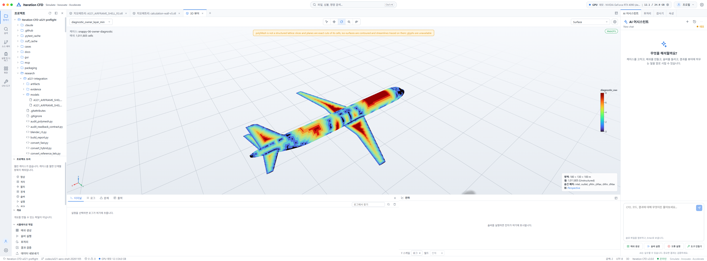
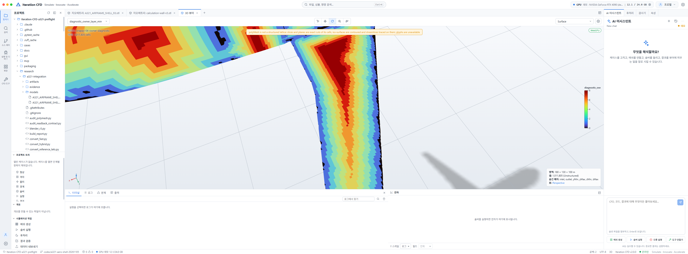
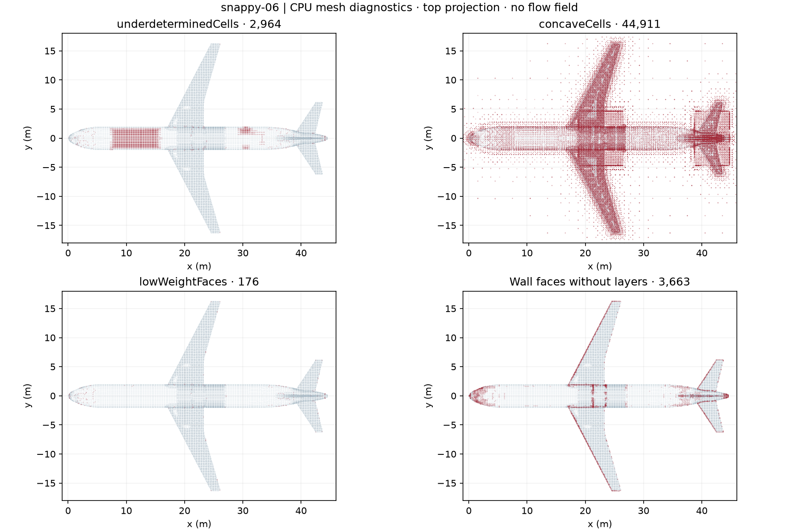
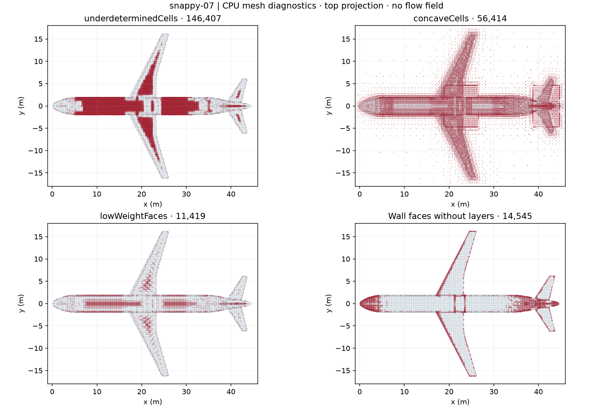

# A321 경계층 개선·재부팅 복구 보고서

**2026-11-08 KST · 저속 목표 30 m/s·받음각 0° · R3 보존 · 항공기 GPU 해석 HOLD**

컴퓨터 종료 전에 끝난 CPU 실험과 원시 데이터를 다시 확인하고 작업을 복구했다. **snappy-06은 층 생성 면적 92.76%, 비직교 65.44°, 상대 폐합 5.52×10⁻¹⁵**였다. 그러나 **확장 검사 3개 실패**와 형상·벽처리의 미확정 조건이 남아 있어 항공기 해석은 실행하지 않았다. 이 보고서의 색상은 압력·속도가 아니라 **실제 mesher가 만든 층 수**다.

## 지금까지와 준비 상태 {#progress}

**GPU 전 체크포인트 8개 중 3개 완료**를 유지한다. 새 후보와 시각화는 4~6번의 연구 진전이며 공학적 합격으로 대신 세지 않았다.

| 순서 | 체크포인트 | 상태 | 현재 증거·남은 기준 |
|---:|---|---|---|
| 1 | R3 동결·보존 | 완료 | STL 원 SHA 일치, BLEND·이전 후보 보존. |
| 2 | CPU 후보 생성·Studio 표시 | 완료 | 06·07 계산 완료. 재부팅 후 06의 1,011,805셀과 0~8층 지도 재확인. |
| 3 | 핵심 수치·기본 CPU 검사 | 완료 — 제한적 | 06·07은 70°/1e-10, 양수 체적·폐합·연결·기본 checkMesh 통과. |
| 4 | 기준 형상 적합성 | 부분 | 07의 p95 편차는 개선됐지만 최대 표본 약 46.3 mm, feature 허용오차·전역 보증은 미확정. |
| 5 | 경계층 설계·포착 | 부분 — 크게 개선 | 06 면적 92.76%, 8층 면 2,897개. 실제 첫 높이·총두께·벽처리 적합성은 미검증. |
| 6 | 확장 검사 | 실패 | 06도 determinant·concave·보간 가중치 세 항목 실패. |
| 7 | 실제 엔진 CPU 인수 | 미실행 | 바이너리와 정확한 인수 경로 및 케이스 계약 확인 필요. |
| 8 | GPU 실행 전 검토 | 보류 | 과거 SUPER 메모리 시험만 통과. solver 호환·실제 케이스 메모리·실행 종료 조건 미완료. |

**복구 범위:** 새 계산을 돌려 결과를 다시 만든 것이 아니다. 저장된 mesh·진단·중심 데이터·입력 사전·원시 로그를 해시로 재검증하고 Studio 및 로컬 보고서 서버를 다시 띄웠다. 아래 결과는 2026-11-07의 CPU 실험 결과이며 2026-11-08에 복구·검증했다.

## Ego Lite에서 실제로 보는 경계층 {#studio}

<figure><figcaption><strong>snappy-06 · 0~8층 지도</strong> 고정 범위 0~8. 색은 계산한 압력이 아니라 native layer-count 진단값이다. 표면이 아닌 안쪽 셀의 색을 공력 결과로 해석하지 않는다.</figcaption></figure>
<figure><figcaption><strong>주익·뿌리 부근 확대</strong> 붉은 쪽이 많은 층, 파란 쪽이 적은 층이다. 0과 8 사이 영역도 남으므로 전체 8층 완료가 아니다.</figcaption></figure>

이전 ASCII triangle VTU는 Studio reader에서 실패했다. 이번에는 **원 mesh를 그대로 복사한 시각화 전용 케이스**에 `diagnostic_owner_layer_min`이라는 명시적 진단 scalar만 추가했다. 같은 wall-adjacent owner를 공유하는 면에서는 최소 층 수를 쓴다. 현재 04와 06에서는 충돌이 없고 각각 **벽면 57,556개 모두 원래 face 값과 일치**한다. 비벽 셀은 **-1=미정의**다. 벽 패치만 표시한 화면이며, 색상 보간·조명·표시용 삼각분할은 진단 원장이나 물리적 수치 검사를 대신하지 않는다.

원본 case에 압력·속도·난류장이나 해석 결과를 만든 것은 아니다. 시각화 복사본의 `0/`은 **진단값**이며 CFD가 한 시간 전진했다는 뜻이 아니다. Studio의 데모 GPU 표시는 4080 SUPER 실측이 아니다. [복구 후 화면 상태](evidence/studio-recovery-20261108.json), [06 진단 대응](evidence/snappy-06-owner-layer-diagnostic.json).

## 원인을 분리한 두 CPU 실험 {#trials}

두 후보 모두 snappy-04에서 출발했고 R3와 품질 기준은 그대로다. 06은 **명목 첫 층 1→4 mm만**, 07은 **최소 표면 refinement level 4→5만** 바꿨다. mesh 생성 조건은 유속이나 y⁺를 풀어 계산하지 않는다.

| 항목 | 출발점 04 | 높이 대조 06 | 해상도 대조 07 |
|---|---:|---:|---:|
| 셀 수 | 935,120 | 1,011,805 | 1,260,388 |
| 독립 최대 비직교 | 66.202° | **65.437°** | 66.201° |
| 상대 폐합 | 8.89e-15 | **5.52e-15** | 1.12e-14 |
| 층 생성 면적 | 42.60% | **92.76%** | 83.02% |
| 완전 8층 face | 380 | 2,897 | 11,138 |
| 실제 평균 층 수, native 최종 표 | 1.81 | 3.14 | 3.16 |
| 무층 face / 전체 wall face | 19,948 / 57,556 | **3,663 / 57,556** | 14,545 / 86,436 |
| 작은 determinant 셀 | 28,086 | **2,964** | **146,407** |
| concave 셀 | 38,769 | **44,911** | **56,414** |
| 낮은 보간 가중치 면 | 3,114 | **176** | **11,419** |
| 기본 검사 / native illegal | PASS / 0 | PASS / 0 | PASS / 0 |
| 확장 검사 | 3개 실패 | **3개 실패** | **3개 실패** |
| R3→후보 p95 표본 거리 | 4.244 mm | 4.244 mm | **1.572 mm** |
| R3→후보 최대 표본 거리 | 46.309 mm | 46.309 mm | 46.309 mm |

**연구 해석:** 06은 04보다 셀 수가 약 8.2% 늘면서 층 면적이 약 50.16 percentage points 늘고 determinant·보간 문제는 줄었다. 하지만 concave 셀은 증가했다. 07은 형상 p95와 층 분할이 개선됐지만 작은 determinant 셀이 크게 늘어났다. 이 결과는 **표면 해상도·첫 층 조건을 함께 설계해야 한다**는 근거이며 4 mm가 올바른 물리적 첫 층이라는 결론은 아니다.

후속 경계층 조건 연구는 06을 유력한 대조군으로 삼는다. 07은 형상·분할 효과를 보는 보조 대조군으로 보존한다. 둘 다 engineering acceptance나 GPU 실행용 mesh로 승인하지 않는다. [확정된 수치·해시 원장](evidence/conditioning-comparison.json).

평균 층 수는 로그의 처음 요청 표가 아니라 **마지막 overall thickness 집계 표**에서 읽었다. 검토에서 요청값 8을 평균으로 오인하는 추출 버그를 발견해 수정했고, 실제 04·06·07 로그와 요청 표 대조로 회귀 검사했다. native 표의 평균은 반올림 표시이며 면적 가중 평균과 다르다.

<figure><figcaption><strong>06의 남은 실패 지도</strong> 작은 determinant와 낮은 가중치 면은 줄었지만 오목 셀은 남아 있다. 실패 집합은 서로 겹칠 수 있다.</figcaption></figure>
<figure><figcaption><strong>07의 실패 지도</strong> 더 세밀한 면이 더 좋은 수치 품질을 자동으로 뜻하지 않는다. 두 지도의 점 개수를 같은 셀 해상도로 간주하지 않는다.</figcaption></figure>

## 실제 근벽 위치는 얼마나 달랐나 {#distance}

명목 첫 층 높이와 실제 셀의 벽 이격은 다르다. 저장된 셀 중심에서 명시적 float64 계산 벽 삼각형까지 **최근접 Euclidean 거리**를 모든 wall face의 owner에 대해 구했다. 같은 owner의 반복은 face 가중으로 그대로 센다. 이는 첫 셀 전체 높이, solver가 쓰는 벽 거리장 또는 y⁺ 자체가 아니다.

| 층이 생성된 면의 owner 중심 거리 | 04 | 06 |
|---|---:|---:|
| 최소 | 0.494 mm | 1.228 mm |
| 중앙값 | 2.264 mm | **7.705 mm** |
| p95 | 5.790 mm | **23.185 mm** |
| 최대 | 7.570 mm | **31.646 mm** |

**쉽게 말하면:** 06은 얇은 방이 찌그러지는 문제를 줄여 층을 더 많이 붙였지만, 실제로 바람이 빠르게 변하는 벽 근처를 더 잘 해석하게 됐다는 뜻은 아니다. 다음에는 이 거리를 30 m/s 조건과 선택한 벽처리의 요구에 맞춰 판단해야 한다. 전단응력과 마찰속도를 아직 계산하지 않아 solved y⁺는 없다. [04 거리](evidence/snappy-04-wall-center-distance.json), [06 거리](evidence/snappy-06-wall-center-distance.json).

## 선택하신 첫 공력 시험 준비 {#flow}

**사용자 선택: 30 m/s·기준 받음각 0°의 저속 외부유동 기초시험.** 순항·고받음각 성능 시험이 아니며, 원형 A321의 비행 인증이나 정확한 항력 값을 목표로 삼지 않는다.

| 항목 | 준비 명세 | 판정 경계 |
|---|---|---|
| 속도·방향 | 계획 U=(30,0,0) m/s | 모델의 nose→tail +X 기준. 실제 솔버 입력은 아직 생성하지 않음. |
| 받음각 | 모델 기준축 상대 0° | 공력적 zero-lift 각도라는 뜻은 아님. |
| 물성 | 임시 계획 상수 ρ=1.225 kg/m³, ν=1.5e-5 m²/s | 실제 고도·온도·풍동 측정값이 아님. 대기 조건 확정 전의 가정. |
| 동압 | 가정으로부터 q=551.25 Pa | 해석 결과 압력이 아니라 ½ρU² 계산값. |
| Reynolds 수 | 단위 길이당 U/ν=2,000,000 m⁻¹ | Re=UL/ν. 기준 길이·면적은 미확정이며 계수를 내지 않음. |
| 형상·벽 | R3 연구 셸, stationary no-slip wall 계획 | 엔진·파일런·착륙장치 생략. 실제 벽처리·난류 모델은 미선정. |
| 바깥 경계 | xMin 입구·xMax 출구, 나머지는 외부 유동 경계 계획 | 움직이는 지면으로 취급하지 않음. 엔진 지원 계약 확인 필요. |
| 출력·종료 조건 | 잔차·질량 보존·힘 이력·벽 진단 계획 | 반복 한도·안정화·중단 기준은 CPU 인수 후 고정. |
| 현재 실행 | 미실행 | 준비 명세만 작성. GPU·CFD 솔버를 시작하지 않음. |

[준비 JSON](plans/low-speed-30ms.json)은 실행용 case.jsonc가 아니다. 난류 입구 조건, 벽처리와 y⁺ 목표, 기준 면적·길이, CPU mesh 인수, VRAM 예산이 닫히기 전에 이를 솔버 입력으로 바꾸지 않는다. [NASA Reynolds 설명](https://www.grc.nasa.gov/www/k-12/airplane/reynolds.html)은 Re=UL/ν 관계의 참고이며, 위 임시 물성이나 A321 해석의 합격 근거가 아니다.

## 남은 단계·복구 증거 {#next}

1. **06의 남은 3,663개 무층 면과 44,911개 concave 셀**을 우선 추적한다. 주익·꼬리 표면의 층 종료부와 전이 셀을 실제 좌표·패치로 분류한다.
2. 30 m/s 조건의 난류·벽처리를 정하고, 실제 중심 거리와 목표 y⁺·총두께를 함께 설계한다. 단순히 명목 첫 높이를 더 키워 mesh 수치만 좋게 만드는 선택은 하지 않는다.
3. 형상 feature 허용오차를 먼저 고정하고 07에서 확인한 세분화 이점을 선별 적용한다. 최대 약 46.3 mm 표본 이탈은 미해결이다.
4. 동일 70°/1e-10·양수 체적·접합·전역 충돌 및 확장 검사로 다시 판정한다. 실제 ofgpu CPU 인수와 실행 바이너리·CUDA/SM89 호환·메모리 예산도 확인한다.
5. 모든 조건이 닫힌 뒤에만 GPU 짧은 시험을 검토한다. 이번에는 GPU 메모리 진단도 반복하지 않았다.

컴퓨터 종료는 mesh 생성 완료 뒤였다. 저장된 06·07의 입력과 원시 출력, 진단·중심 데이터·시각화 복사본을 재대조했다. 상대 경로 runner 복사 문제와 다른 mesh의 seal을 섞을 수 있는 경로는 수정하고 회귀 검사를 추가했다. 원래 실행된 runner 복사본과 수정 후 파일은 구분한다. 자세한 복구·검토 범위는 [복구 기록](evidence/recovery-20261108.json)에 남긴다.

## 이전 연구·API 기록 {#history}

직전의 실패 지도·03→04/05 비교·GPU 메모리·API/OpenCodex 검토, 초기 준비표와 2026-11-06 상세 원문은 아래 접기 항목에 모두 보존했다. OpenCodex 실제 게이트웨이 연결은 미검증이며 이 복구에서 전역 API 설정을 바꾸지 않았다. [API 검토](API_KO.md).

[NASA V&V tutorial](https://www.grc.nasa.gov/www/wind/valid/tutorial/tutorial.html)의 반복·공간 수렴과 실험 검증은 앞으로의 별도 단계다. 현재 화면 로딩이나 mesh gate가 공력 validation을 대신하지 않는다.
