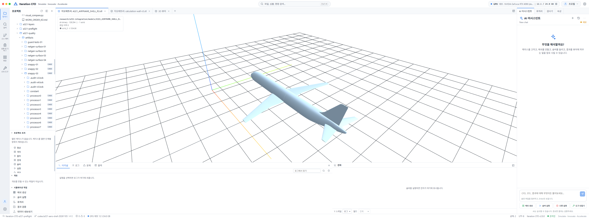
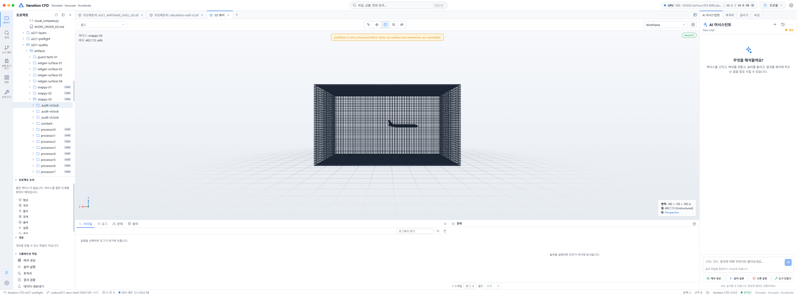
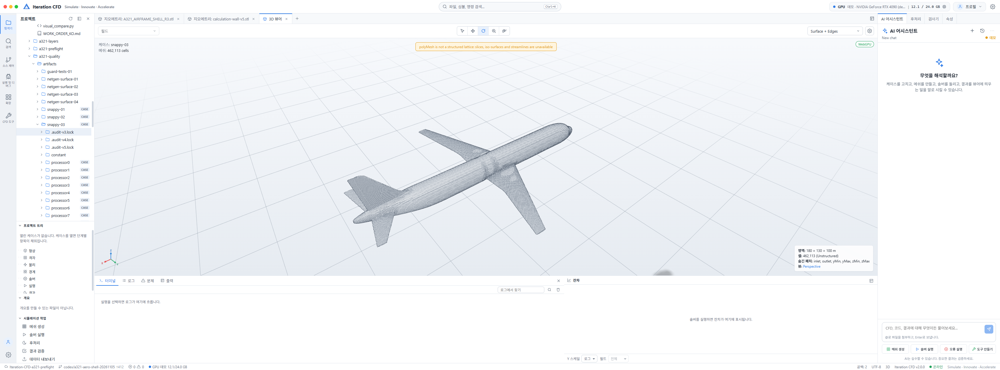
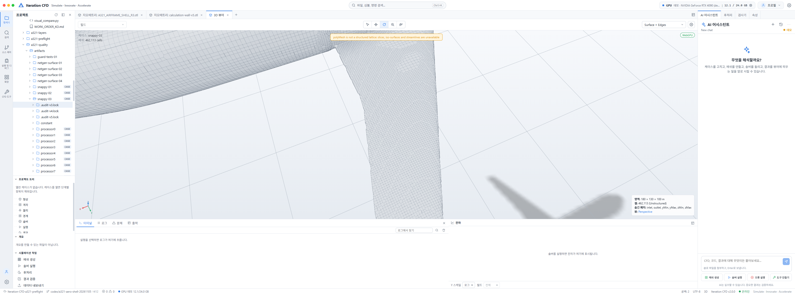
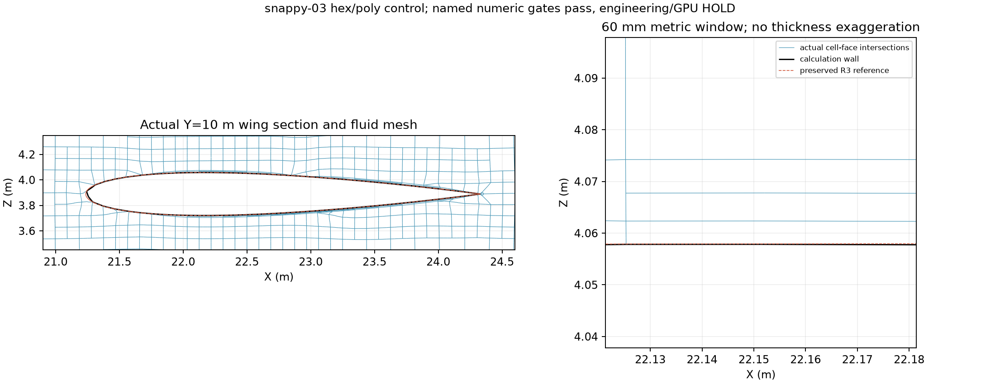

# A321 공력 해석 준비 보고서

**2026-11-07 KST · GPU 해석 보류 · CPU 격자 후보 snappy-03**

R3 원본은 보존했다. 계산에 쓸 별도 벽면과 **462,113셀** 격자를 만들었고, 비직교 **66.20°**, 상대 폐합 **8.26×10⁻¹⁵**로 정해 둔 두 수치 기준을 통과했다. 그러나 확장 검사 **3개 실패**, 경계층 면적 **33.3%**, 형상 허용오차 **미확정** 때문에 항공기 GPU 솔버는 실행하지 않았다.

## 한눈에 보는 진행률 {#progress}

**GPU 실행 전 체크포인트 8개 중 3개 완료.** 아래 표의 완료 행만 센 값이다. 단계의 중요도나 남은 시간에 가중치를 둔 공학적 완성률이 아니다. 현재 우선순위는 **4~6번 병행 → 7번 → 8번**이다.

| 순서 | 체크포인트 | 상태 | 지금까지 확보한 것 / 완료 조건 |
|---:|---|---|---|
| 1 | 기준 형상 동결 | 완료 | R3 STL SHA256 일치, BLEND·STL 변경 없음. 파생 모델은 별도 경로에 보관. |
| 2 | CPU 격자 후보 생성·표시 | 완료 | snappy-03의 저장된 polyMesh와 벽면을 Studio에서 확인. hex/poly 대안이며 사면체 경로의 합격은 아님. |
| 3 | 핵심 수치·기본 CPU 검사 | 완료 | 최대 비직교 ≤70°, 상대 폐합 ≤1×10⁻¹⁰, 비양수 체적 0개, 유체 연결 성분 1개, 기본 checkMesh 통과. |
| 4 | 계산 벽면의 형상 적합성 | 부분 | 양방향 오차를 표본 측정. 기능부별 허용오차를 먼저 명시하고 앞전·뒷전·날개 뿌리·끝단·꼬리 단면으로 재검증. |
| 5 | 경계층 설계·포착 | 부분 | 면적 33.3%에 한 층 이상. 유동 조건과 벽처리에 맞춰 패치별 첫 높이·총 두께·층 수·면적 목표를 정하고 충족. |
| 6 | 확장 격자 품질 | 실패 | 작은 determinant, 오목 셀, 낮은 보간 가중치를 위치별로 분석하고 수정. 같은 핵심 수치 기준과 확장 검사 실패 0개를 다시 확인. |
| 7 | ofgpu 케이스·CPU 인수 검증 | 미실행 | 경계 조건·물리 모델·단위·패치 매핑을 확정. 실제 엔진의 격자 인수 검사를 CPU 범위에서 확인하고, 없으면 별도 인수 검사 경로를 마련. |
| 8 | GPU 실행 준비 검토 | 보류 | 4~7번 완료 후 실제 바이너리/SM89 호환, 케이스 메모리 예산, 짧은 시험 중단 조건을 기록. 항공기 GPU 시험은 이번 범위 밖. |

## Studio 갤러리 {#gallery}

<figure><figcaption><strong>01 · R3 기준 형상</strong> 원본 STL을 열었다. 이 보고서 작업으로 새 형상을 만들거나 기존 R3를 수정하지 않았다.</figcaption></figure>

<figure><figcaption><strong>02 · 계산용 벽면</strong> 같은 R3를 기준으로 생성한 snappy-03의 실제 계산 벽면이다. CAD 원본이나 공력 해석 결과가 아니다.</figcaption></figure>

<figure><figcaption><strong>03 · 전체 유동 영역</strong> 180 × 130 × 100 m, 462,113셀, 7개 경계. 모든 경계 패치를 켠 외곽 와이어프레임이며 내부 셀 전체를 그린 화면은 아니다.</figcaption></figure>

<figure><figcaption><strong>04 · 전체 항공기 벽면 격자</strong> 같은 polyMesh에서 풍동 경계 6개를 숨기고 aircraft 패치만 표시했다.</figcaption></figure>

<figure><figcaption><strong>05 · 날개 주변 확대</strong> Studio의 표면 및 모서리 표시. 보이는 선은 벽면 표시용 삼각 분할을 포함하며 경계층 내부 셀을 뜻하지 않는다.</figcaption></figure>

<figure><figcaption><strong>06 · 경계층 안쪽을 보는 실제 단면</strong> 저장 polyMesh를 Y=10 m에서 자른 독립 CPU 도식. 오른쪽은 60 mm 창이며 두께 과장이 없다. Studio 스크린샷과 구분한다.</figcaption></figure>

이미지를 누르면 원본 크기로 열린다. [새 Studio 표시 상태 원장](evidence/studio-20261107-receipt.json)에 후보명, 셀 수, 표시·숨김 패치와 카메라를 기록했다. Studio 상단의 데모 GPU 표시는 실제 RTX 4080 SUPER 측정이 아니다. 비정렬 단면 UI 시험에서는 레이어를 추가했지만 내부 셀이 화면에서 확인되지 않아 **단면 표시 통과로 계산하지 않았다**. 이번 보고서의 내부 단면 근거는 독립 CPU 도식이다.

## 남은 단계와 통과 증거 {#next}

| 우선 | 할 일 | 합격을 판단할 산출물 |
|---:|---|---|
| 1 | **무층 영역 지도**: 동체·날개 뿌리·앞/뒷전·끝단·꼬리로 나눠 무층 위치와 이유를 찾는다. | 영역별 전체/층 생성 면적, 0~8층 분포, 최소/중앙 두께, 잘린 위치. 현재 51,685면 중 22,090면 무층, 8층은 33면. |
| 2 | **형상과 층을 함께 수정**: 우선 비행 조건·Reynolds 수·벽처리를 정하고 첫 층 높이와 총 두께 목표를 고정한다. 형상 오차가 큰 곳에는 국소 세분화와 층 종료·전이를 적용한다. | 수정 전 고정한 패치별 형상 및 층 허용 기준, 양방향 거리·단면 차이·층 높이 실측, 후속 격자의 영역별 기준 충족. 현재 명목 1 mm는 측정된 첫 층이 아니다. |
| 3 | **확장 실패 제거**: 14,798개 작은 determinant 셀, 29,759개 오목 셀, 2,624개 낮은 보간 가중치 면을 위치별로 분류하고 재격자화한다. | 신규 후보에 동일 70°/1e-10 기준, 양수 체적·연결·접합·전역 충돌 검사, 확장 검사 실패 0개. 이전 실패 원장 유지. |
| 4 | **ofgpu 케이스 준비**: 유동 조건, 기준 면적·길이, 항력/양력 방향, 초기·경계 조건, 솔버 설정을 고정한다. | 정확한 모델/격자 SHA와 입력 사전, CPU mesh 인수 결과. Studio에서 읽혔다는 사실만으로 대체하지 않는다. |
| 5 | **GPU 직전 점검**: 위 조건이 닫힌 후에만 RTX 4080 SUPER용 바이너리/SM89 및 CUDA 호환, VRAM 예산과 시험 종료 조건을 확인한다. | 버전·장치·예상 사용량과 안전 여유를 담은 실행 계획. 예전 VRAM 접근 시험은 항공기 규모의 적합성 검사가 아니다. |

**다음 작업의 시작점:** 로컬 `artifacts/snappy-03/constant/polyMesh/sets/`에 `underdeterminedCells`, `concaveCells`, `lowWeightFaces`가 남아 있다. 이 ID를 같은 후보의 셀·면 좌표에 연결하면 문제 위치를 좁힐 수 있다. 경계층은 processor별 `0/nSurfaceLayers`와 `0/thickness`에서 시작한다. 실패 집합은 서로 겹칠 수 있으므로 개수를 더해 전체 불량 셀 수로 보고하지 않는다. 재격자화하면 ID가 바뀌므로 구·신 후보의 ID를 직접 비교하지 않는다.

**두께 수치를 읽는 법:** 명목 첫 층 1 mm는 입력값이다. 층이 생긴 면에서 mesher가 기록한 전체 층 두께의 중앙값은 **16.22 mm**, 최소는 **0.835 mm**였다. 이 값은 첫 셀 높이나 해석 후의 y⁺가 아니다. [층 원시 집계](evidence/snappy-03-layer-fields.json)에 0~8층 분포가 있다.

**나중 단계:** GPU 짧은 시험 뒤에도 잔차, 질량 보존, 양력·항력 이력, 격자 수렴, 비교 실험 검증이 필요하다. 이번 보고서에는 압력·속도·공력 계수·해석 결과가 없다. A321 형상은 엔진·파일런 등을 생략한 연구용 겉껍데기다.

## 이전 연구를 잇는 기록 {#history}

| 연구 단계 | 확인한 결과 | 다시 열기 |
|---|---|---|
| CPU 사전 검토 | 참조 모델과 메싱 기준선을 정하고 원 형상의 제약을 기록했다. | [초기 사전 검토](../a321-preflight/report.html) |
| R2 공력 셸 | 외형용과 해석용을 분리했다. R2와 R3 사이 날개 홈·뒷전 복원 변경을 추적했다. | [R2 셸 연구](../a321-shell/report.html) |
| R3·Studio·VRAM | R2/R3 Studio 표시와 초기 hybrid 변환을 확인했다. 1 GiB 할당·64 MiB 왕복 시험은 메모리 접근 진단이었다. | [통합·VRAM 연구](../a321-integration/report.html) |
| R3 고정 8층 연구 | 1,036,176개 프리즘의 비양수 국소 Jacobian 0개. 전체 1,251,054셀의 비직교 89.99° 및 상대 폐합 4.01×10⁻¹⁰으로 해석용 불합격. | [경계층 연구와 단면](../a321-layers/report.html) |
| hex/poly 대안 | 두 수치 기준과 기본 검사 통과. 전 표면 층, 형상 허용오차, 확장 검사는 미완료. 아래 상세 기록에 모든 수치와 실패 후보를 보존했다. | [최종 감사](evidence/snappy-03-audit-v5.json) |

## 상위 저장소 동기화 {#upstream}

상위 저장소 [using76/Iteration-CFD main의 1475bbf](https://github.com/using76/Iteration-CFD/commit/1475bbf781e08f33f681661ec40e00727f1e7021)를 연구 브랜치에 병합했다. 기존 보고서와 격자는 병합에서 변경되지 않았다. 출처 문서 한 곳의 충돌을 해결해 상위 Blender 어댑터 목록과 A321 연구 출처를 함께 보존했다.

상위 저장소의 polyMesh 인수 개선과 검증·검정 계획은 **다음 준비 작업의 참고**다. 이 변경이 A321 격자를 솔버에서 승인하거나 GPU 해석을 실행한 증거는 아니다. 새 스크린샷은 병합 뒤 연구용 Studio의 루프백 주소 `127.0.0.1:5185`에서 얻었다. 아래 ‘Ego Lite Studio 실제 확인’은 이전 실행 기록이다.

## 상세 실험 원문 {#detail}

아래는 기존 2026-11-06 상세 보고서다. 후보별 실패, 감사 방법, 경계층 및 형상 수치, 재현 문서를 삭제하거나 요약으로 대체하지 않았다.
