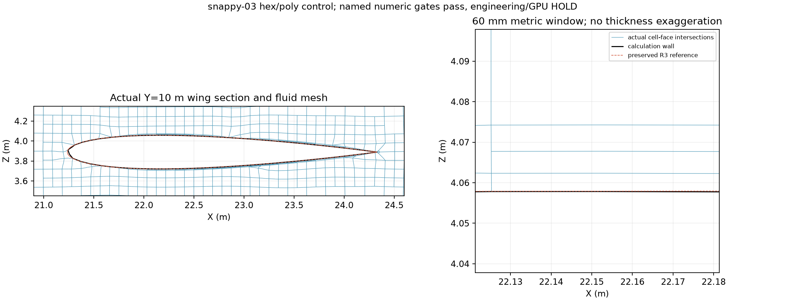
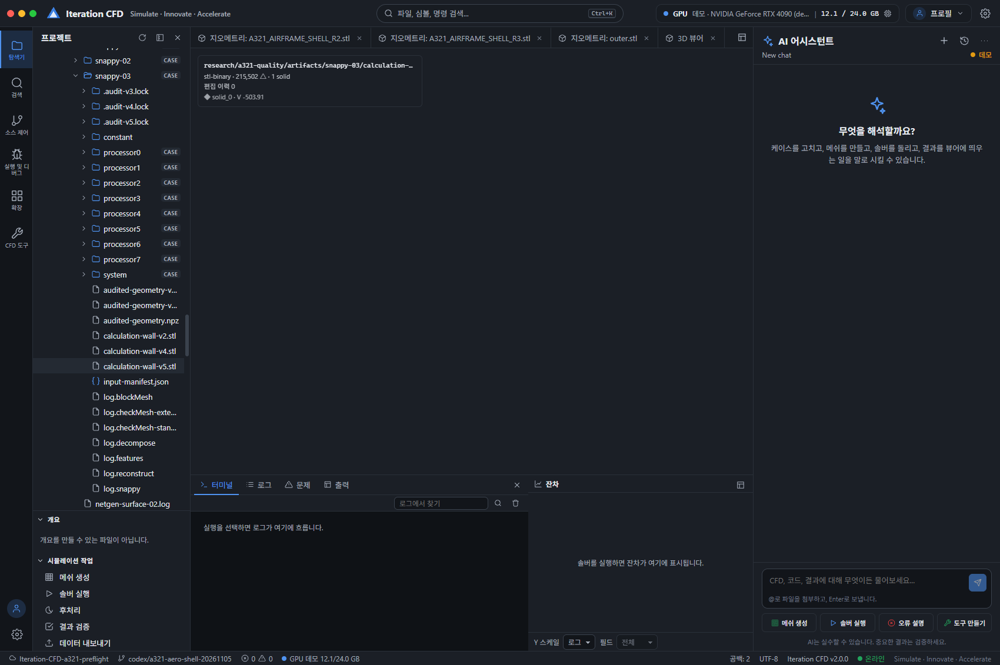

# A321 R3 계산 격자 품질 연구 — 2026-11-06

**결론: 비직교·상대 폐합과 기본 CPU mesh 검사는 통과했다. 전체 연구 목표는 PARTIAL이며 항공기 GPU 해석은 계속 HOLD다.**

유효 수치 후보는 `snappy-03`이다. R3 STL·BLEND 원본을 보존하고, 원 R3를 입력으로 계산용 벽면 분할·경계층·외부 격자를 함께 다시 생성했다. 이번에 통과한 것은 **hex 중심 polyhedral 대안**이다. 기존 사면체 경로가 합격했다거나 항공기 해석이 완료됐다는 뜻은 아니다. 확장 품질, 층 포착 범위, 형상 허용오차는 아래에 실패·미확정으로 그대로 남긴다.

## 실제 판정

| 검사 | 결과 | 기준·범위 |
|---|---:|---|
| 원 R3 SHA256 | 일치 | 원본 파일 변경 없음 |
| 셀 / 점 / 면 | 462,113 / 553,581 / 1,473,152 | 저장된 polyMesh 재읽기 |
| 유체 연결 성분 | 1 | 전체 내부 face graph |
| 비양수 체적 | 0 | 최소 체적 3.840634e-6 m³ |
| 최대 비직교, 수정된 독립 적분 | **66.203955°** | **≤70°: PASS** |
| 70° 초과 내부 면 | **0** | 전체 1,409,115 내부 면 |
| 최대 상대 폐합 | **8.259123e-15** | **≤1e-10: PASS** |
| 원시 wall ID 폐합·winding | PASS | 좌표 병합 없이 signed edge incidence 검사 |
| native mesher 최종 illegal faces | 0 | 전체 생성 종료 로그 |
| 기본 checkMesh | Mesh OK | 외부 CPU 검사 PASS |
| 최대 skewness, native | 2.999645 | 기본 검사 PASS |
| 확장 checkMesh | **3개 검사 FAIL** | 전체 공학적 합격으로 승격하지 않음 |
| 항공기 GPU / flow solver | **미실행** | GPU_HOLD 유지 |

근거: [최종 독립 감사 v5](evidence/snappy-03-audit-v5.json), [판정 원장](evidence/acceptance.json), [기본 검사](evidence/snappy-03-standard.log), [확장 검사](evidence/snappy-03-extended.log), [mesher 로그](evidence/snappy-03-mesher.log).

폐합은 이전과 똑같이 **`|ΣSf| / V^(2/3)`**로 계산했다. OpenFOAM의 `cell openness`와 분모를 바꾸어 통과시키지 않았다. 기본 도구가 출력한 비직교 최댓값 64.924239°와, 삼각형별 signed 체적·1차 모멘트로 구한 독립값 66.203955°를 구분한다. 둘 다 70° 이하이며 보고에는 더 큰 독립값을 사용한다.

v2 감사는 오목 면의 절댓값 면적 가중·warped 면의 중심 축약 문제가 있었다. v4는 평면 U형·비평면 큐브·실제 warped face 반례로 계산법을 수정한 뒤 같은 polyMesh를 다시 읽었다. v2 기록은 삭제하지 않았으며 최종 acceptance에는 v5만 사용한다. 현재 mesh의 다섯 파일 SHA와 후보·원본 SHA가 감사 영수증과 일치하지 않으면 패키징을 거부한다.

최종 v5에서는 읽기 전과 출력 직전에 다섯 파일 SHA를 비교해 감사 도중 변경도 거부했다. v4와 수치는 동일했으며, v5 영수증의 `mesh_unchanged_during_audit`는 이 실제 재실행 결과다.

## 이번에 바꾼 방법

이전 프리즘·사면체 격자는 최대 비직교 89.9927°, 폐합 4.0103e-10이었다. 뒤집힘을 피하려고 일부 층이 약 32nm까지 줄어들었다. 독립 진단에서 나쁜 프리즘 면 대부분은 층 사이가 아니라 **가늘고 긴 바닥 삼각형의 옆면**이었다. 더 얇게 만드는 것만으로는 해결되지 않았다.

새 대조 경로는 R3 표면을 기준으로 외부 hex를 국소 세분화하고 표면에 맞춘 뒤, 내부 mesh를 함께 이동시켜 층을 넣는다. 원 STL 삼각형과 계산 벽면의 분할은 서로 다르다. 따라서 원본 보존과 파생 계산 형상의 오차는 각각 검사했다. WSL Ubuntu 24.04에 설치한 외부 OpenFOAM **1912.200626-2build3**의 `blockMesh`, `surfaceFeatureExtract`, `snappyHexMesh`, `checkMesh`만 CPU 도구로 사용했다. 최신 버전이라고 주장하지 않는다. 프로젝트 solver 구현에는 외부 코드를 복사하지 않았고 GPL 구현 소스는 읽지 않았다.

| 후보 | 실제 결과 | 처리 |
|---|---|---|
| snappy-01 | 두 수치 기준 통과, skewness 및 확장 검사 실패 | 대조 기록 보존 |
| snappy-02 | 기본 `Mesh OK`지만 최대 비직교 **70.147065°**, native illegal 211개 | 명시 기준 위반으로 제외 |
| snappy-03 | 01에서 skewness 제한만 3으로 강화. 두 수치 기준·기본 검사·native 0 illegal 통과 | 제한된 CPU 수치 후보 |
| Netgen binary/ASCII/단순화 표면 | Windows control-byte 입력 문제, tiny-point 처리·열린 출력·나쁜 최소각 확인 | 사면체 후속 입력으로 승격하지 않음 |

사면체 raw 출력의 경계 정점 2개는 삭제가 아니라 미세 이동이었다. 국소 좌표 복구 시험에서는 영향받는 사면체가 양수였지만, 이를 전체 사면체 합격으로 확대하지 않았다. 상세 근거는 [DIAGNOSIS_KO.md](DIAGNOSIS_KO.md)에 있다.

## 경계층: 요청과 실제를 구분

설정은 첫 층 **명목 1mm**, 성장률 1.2, **8층 요청**이다. 실제로 모든 표면에 8층이 생긴 것은 아니다.

| 측정 | 결과 |
|---|---:|
| 벽면 face 수 | 51,685 |
| 1층 이상 있는 face 수 | 29,595 |
| 면 개수 기준 coverage | **57.2603%** |
| 면적 기준 coverage | **33.2675%** |
| 전체 face 평균 층 수 | **1.4420** |
| 면적 가중 평균 층 수 | **0.8256** |
| 8층을 모두 가진 face | **33개** |
| 무층 face | **22,090개** |

[원시 mesher 진단 필드 집계](evidence/snappy-03-layer-fields.json)는 `nSurfaceLayers`와 `thickness`를 processor별 실제 wall face에 대응시켜 계산했다. 총 두께 필드로부터 실제 첫 층 분포를 추정하지 않았다. solved y+와 점성 경계층 포착 여부는 **미측정**이다. 전 표면 경계층 완성이나 항력 예측 준비 완료로 부를 수 없다.



그림은 실제 mesh의 Y=10m 평면 교차선이다. 파란 선은 계산 셀 면, 검은 선은 계산 벽, 빨간 점선은 보존한 R3다. 오른쪽은 실제 60mm 창이며 두께를 과장하지 않았다. 이 국소 단면의 층 수를 전체 항공기에 일반화하지 않는다.

## 형상 보존과 남은 품질

원 R3 STL SHA256: `2c0111c3bafd34b49b506325e52d13045f997aeaced11236f45b744f08abe745`.

계산 벽면은 raw ID로 닫혀 있고 winding이 일관되지만, R3와 완전히 같은 표면은 아니다. 양방향 12,000개씩의 고정 seed 면적 표본에서:

- R3→계산 벽: p95 **4.312mm**, 최대 **46.308mm**.
- 계산 벽→R3: p95 **4.300mm**, 최대 **34.640mm**.
- 둘러싼 체적: R3 **504.860824m³**, 계산 벽 **503.906822m³**.

이는 전체 Hausdorff 보증이 아니며, 허용오차를 합의해 통과시킨 결과도 아니다. 표본 거리를 본 뒤 임의의 허용치를 만들어 형상을 합격시키지 않았다. 앞전·뒷전·접합부·tip의 별도 feature/단면 검증과 국소 refinement가 남는다.

확장 검사는 작은 determinant **14,798셀**, concave **29,759셀**, 낮은 interpolation weight **2,624면**을 보고했다. concave/warped polyhedron의 양수 체적과 기본 검사 통과가 이 결과를 지우지 않는다. 전역 overlap의 별도 증명도 없으므로 **전체 mesh acceptance와 GPU HOLD 해제는 하지 않는다**.

## Ego Lite Studio 실제 확인

Ego TaskSpace 8에서 `http://127.0.0.1:5183/`를 사용했다. 실제 계산 벽면 STL을 열고, snappy-03 polyMesh를 462,113셀·553,581점·7개 patch로 읽어 3D viewer에서 확인했다. [완료 reader manifest](evidence/studio-snappy03-status.json), [DOM](evidence/studio-snappy03-dom.json), [실제 계산 벽](evidence/studio-calculation-wall.png), [실제 polyMesh 화면](evidence/studio-snappy03.png)을 남겼다.



기본 polyMesh 표면 화면은 외부 풍동 박스가 항공기를 가린다. 별도 geometry 탭은 실제 계산 벽을 보여 준다. reader의 `geometryFidelity: exact`는 **polyMesh 데이터를 읽는 정확도**이며 계산 벽이 R3와 정확히 같다는 뜻이 아니다. 내보낸 벽의 법선은 유체 영역의 바깥, 즉 항공기 안쪽을 향하므로 geometry viewer의 닫힌 벽 체적은 약 **-503.91**로 표시된다. 이는 양수 유체 셀 체적 검사와 별개다.

상단 GPU RTX4090/24GB와 AI 패널은 데모 표시다. 4080 SUPER 실측이나 실제 AI solver 실행 증거가 아니다. fields/times는 비어 있으며 pressure·velocity·공력 계수는 생성하지 않았다. 비정렬 polyMesh의 slice/iso/streamline 제한도 그대로 표시된다. 별도 AI API 키나 외부 AI 호출은 필요하지 않았다.

## 다음 연구 순서

```text
R3 원본 고정 [완료]
 → 계산 표면·경계층·외부 mesh 공동 생성 [hex/poly 대안 완료]
 → 비직교·동일 정의 폐합·기본 CPU 검사 [PASS]
 → 형상 feature/허용오차 + 전 표면 경계층 + 확장 품질 [FIX_FIRST]
 → 실제 ofgpu CPU mesh acceptance [미실행]
 → GPU 메모리/짧은 항공기 시험 [HOLD]
 → 반복수렴·격자수렴·공력 validation [미실행]
```

다음에는 33.3%라는 면적 coverage가 가리키는 무층 영역을 패치별로 분류하고, 표면 feature를 보존한 국소 분할·층 종료/전이·근벽 해상도를 설계해야 한다. 유속·Reynolds 수·벽처리에 맞는 첫 층과 총 두께를 정하고, 확장 검사 실패를 수정·재검증해야 한다. 사면체를 유지하려면 별도의 feature-preserving surface remesh와 접합을 검증해야 하며 현재 hex/poly 수치 성공으로 대체할 수 없다.

[NASA CFD V&V tutorial](https://www.grc.nasa.gov/www/wind/valid/tutorial/tutorial.html)의 과정·오차·격자수렴·validation 구분을 유지한다. 70°/1e-10은 이 연구가 유지한 프로젝트 기준이며 NASA의 A321 합격 기준으로 인용하지 않는다. 외부 hex/layer 방식의 공개 개요는 [OpenFOAM meshing guide](https://doc.cfd.direct/openfoam/user-guide-v13/snappyhexmesh)를 참고했으며 실제 설치 버전·사전 설정·실행 로그를 우선 증거로 삼았다.

재현·보관은 [RUNBOOK_KO.md](RUNBOOK_KO.md), 검토는 [REVIEW_KO.md](REVIEW_KO.md), 정확한 입력·출력 해시는 [artifact-manifest.json](evidence/artifact-manifest.json)을 참고한다.

## 중단 후 현재 상태

2026-11-09 재개 기준은 [상세 핸드오프](HANDOFF_20261109_KO.md)와 [현재 실행 상태](EXECUTION_STATUS_KO.md)다. 아래의 snappy-03 기록은 당시 실험으로 보존한다. 이후 R4/06~11 비교와 R5-A/C 생성·실패, B 생성 전 거부까지 별도 원장으로 이어졌으며 현재 C 자기교차15위치로 M3 FAIL, 항공기 GPU HOLD다. [핸드오프 HTML](handoff-20261109.html)·[실행상태 HTML](execution-status.html).
