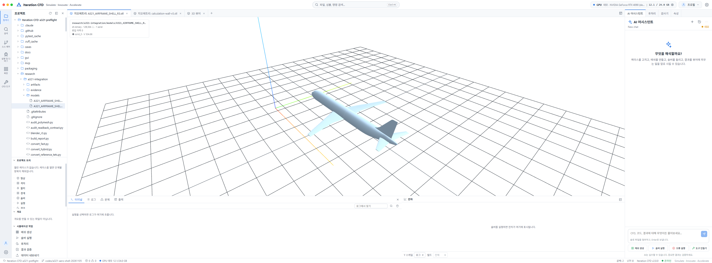
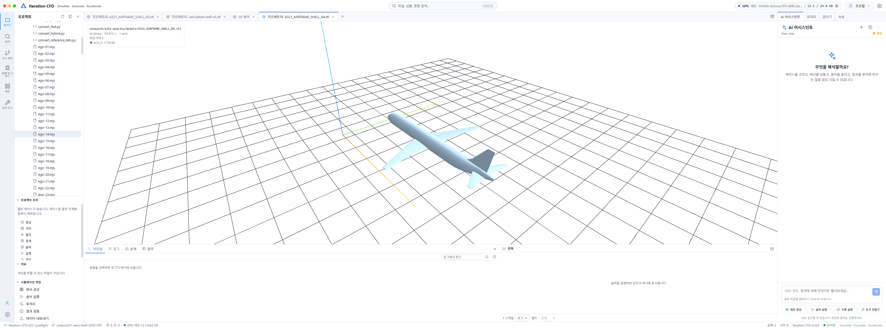
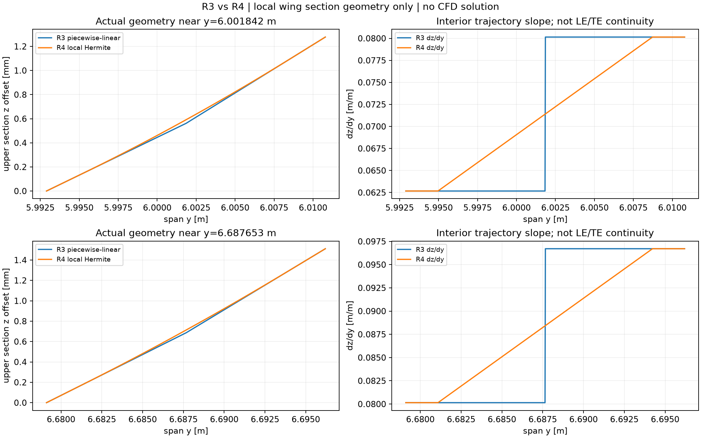
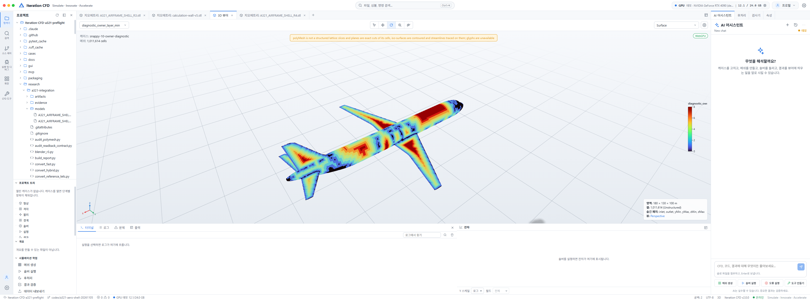
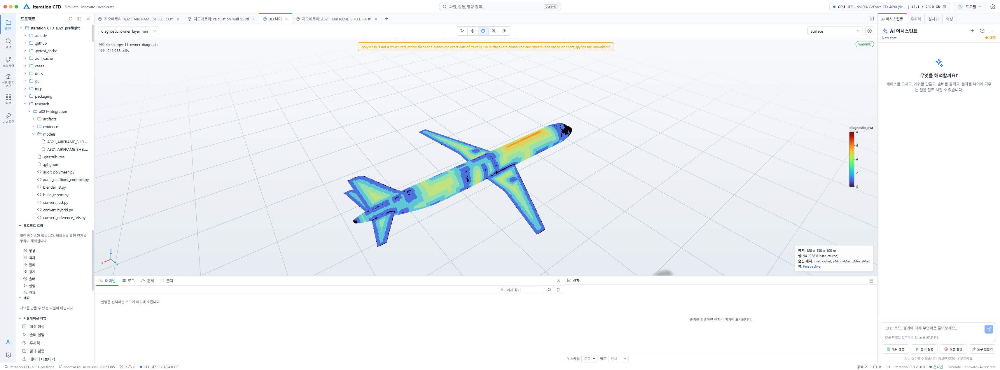
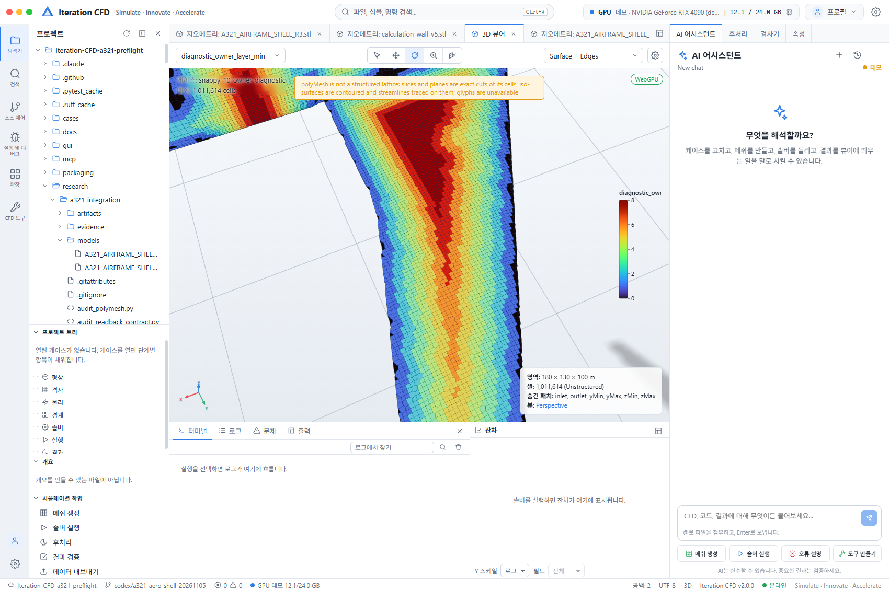
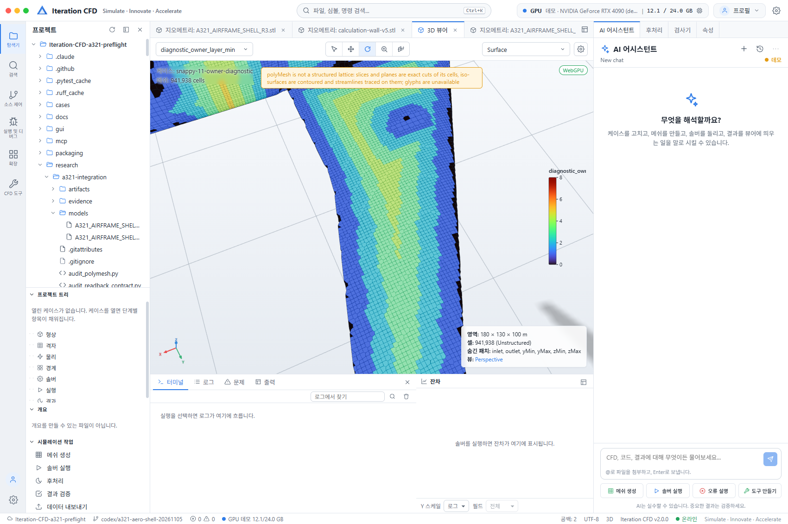
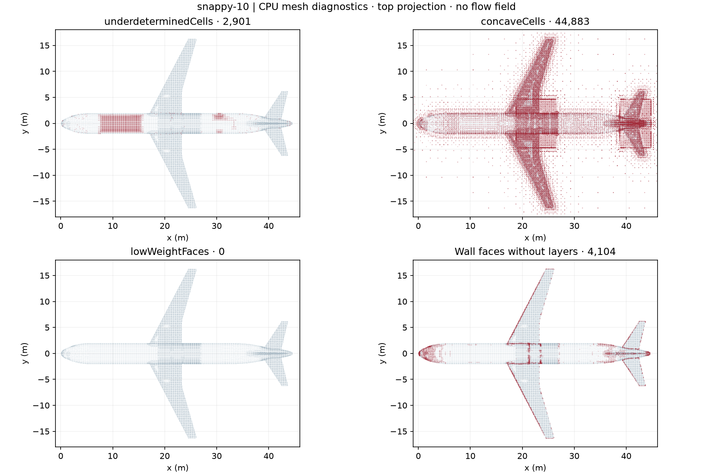
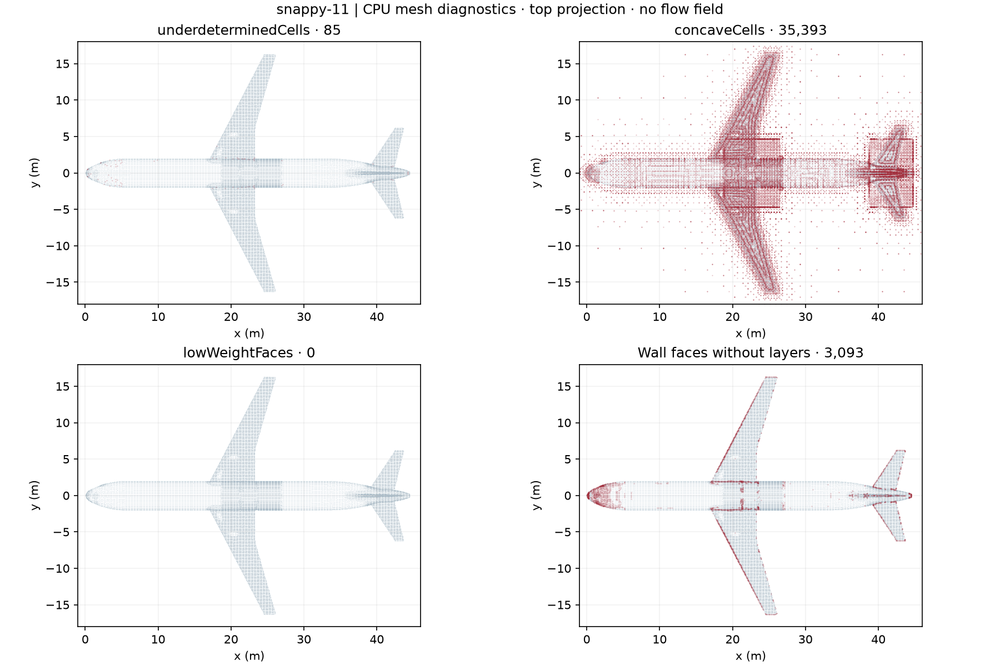

# A321 R3 보존·R4 표면 및 격자 개선 연구

**2026-11-08 KST · 30 m/s·기준 받음각 0° 준비 · GPU 해석 HOLD**

R3를 원본으로 보존하고 **날개 연결부를 국소적으로 다듬은 R4 모델**을 만들었다. 별도 Blender 파일을 저장하고 새 프로세스에서 정점·삼각형을 정확히 재읽고 시험 STL과도 대조했다. 새 CPU 후보 08~11을 모두 생성·재검사했다. **08·10·11에서 낮은 보간 가중치 실패를 해소했고, 09에는 182면이 남았다.** 작은 determinant·오목 셀 실패는 모든 후보에서 남았다. **부분 개선 / 공학적 품질 미통과 / 항공기 GPU 해석 미실행**이다.

## 현재 진행률·통과 기준 {#progress}

**GPU 전 체크포인트 8개 중 3개 완료를 유지한다.** 이는 단계 개수이며 공학적 완성도나 예상 계산 성공 확률의 백분율이 아니다.

| 순서 | 체크포인트 | 상태 | 확인·통과 기준 |
|---:|---|---|---|
| 1 | 원본·기준선 보존 | 완료 | R3 STL·BLEND, 03~07 이력 보존. 새 후보는 별도 경로. |
| 2 | 계산 후보·화면 표시 | 완료 | R3·별도 R4 표시, 새 08~11 CPU 생성·재읽기. 08·11 층 수·격자 화면 비교. |
| 3 | 기본 CPU 수치 | 완료 — 제한적 | 08~11도 독립 비직교 ≤70°, 상대 폐합 ≤1e-10, 양수 체적, 단일 연결·폐합·방향 검사 통과. 확장 검사는 별도 미통과. |
| 4 | 형상 적합성 | 부분 | 국소 R4 생성·위상·재읽기 확인. 앞전/뒷전·실제 익형·전체 매끄러움·전역 교차·허용오차는 미완료. |
| 5 | 경계층 포착 | 부분 | 면적뿐 아니라 실제 층 수·누락 위치·두께를 함께 판단. 8층 요청을 평균 8층으로 기록하지 않음. |
| 6 | 확장 품질 검사 | 미통과 | 작은 determinant·오목 셀·낮은 보간 가중치 검사. 실패를 0으로 숨기거나 기준을 낮추지 않음. |
| 7 | 실제 엔진 CPU 인수 | 미실행 | 정확한 solver 바이너리·mesh 계약과 CPU 인수 확인 필요. 이번 작업에 유동 solver 없음. |
| 8 | GPU 실행 전 검토 | 보류 | 물리 설정·엔진 지원·VRAM 예산·중단 기준까지 확인해야 함. |

## 매끄럽지 않은 모델을 어떻게 고쳤나 {#models}

쉽게 말해 R3는 단면들을 직선으로 연결한 삼각형 껍데기다. 끊긴 홈을 메운 뒤에도 연결 지점의 기울기는 갑자기 바뀔 수 있다. 이번 R4는 그중 날개의 일부 연결부를 **끝점과 기울기를 맞추는 곡선**으로 다듬은 연구 파생 형상이다. 색상이나 조명을 바꾼 것만이 아니라 실제 정점 좌표와 삼각형을 새로 만들었다.

별도 모델 열기: [R4 Blender 파일](models/A321_AIRFRAME_SHELL_R4.blend), [R4 STL](models/A321_AIRFRAME_SHELL_R4.stl). 원본 R3는 기존 integration/models 경로에 보존했다.

| 구분 | R3 기준 | R4 국소 개선 |
|---|---|---|
| 보존 | 원 STL·BLEND 그대로 유지 | models/A321_AIRFRAME_SHELL_R4.stl 및 .blend 별도 저장 |
| 변경 범위 | 기존 무슬롯 연속 외형 | 날개 내부 단면 궤적 6개 연결 지점 주변만 보간, 좌우 미러 |
| 이동 | 기준선 | 최대 대응 단면 이동 **0.250164 mm**. 절대 상한 10 mm와 국소 edge 기반 제한 중 더 작은 값 사용 |
| 앞전·뒷전 | 기존 기준 | 해당 대응 점을 정확히 고정. 원래 outline 꺾임은 유지 |
| 위상 | 이전 검증 보존 | 154,098 삼각형, 정점 77,051개, 경계·비다양체 edge·중복·퇴화면 0, vertex-link 실패 0, 연결 성분 1 |
| Blender 재읽기 | 원본 저장 안 함 | 새 프로세스에서 좌표·삼각형 정확 일치 |
| 남은 한계 | OEM·공력 정확도 미검증 | 전체 NURBS 곡면 재설계 아님. STL은 여전히 조각별 평면. 앞전/뒷전 포함 전역 C1·익형·전체 교차는 미검증 |

R3→R4와 역방향 각각 12,000개 표본 거리의 최대는 **0.008338 mm / 0.039099 mm**다. 표본이 좁은 변경 구간을 놓칠 수 있어 이 숫자를 전체 최대 편차로 사용하지 않는다. 위 **0.250164 mm는 대응 단면 점의 변경량**, 거리 표본은 서로 다른 측정이다. 극소 triangle angle **0.002787°**도 남아 있어 표면 분할 품질이 모두 해결된 것은 아니다. [형상 원장](evidence/smooth-r4.json), [독립 표면 표본](evidence/smooth-r4-surface-metrics.json), [Blender 저장](evidence/blender-r4.json), [새 프로세스 재읽기](evidence/blender-r4-readback.json), [native·NPZ·시험 STL의 정확한 삼각형 대응 보강](evidence/blender-r4-stl-binding.json). 마지막 보강은 생성 후 추가한 대조이며 원래 생성 시점의 동결인 것처럼 소급하지 않는다.

<figure><figcaption><strong>보존한 R3 기준 모델</strong> 실제 STL 읽기. 화면 삼각형 수는 표시용 용접·퇴화면 제외 때문에 정확 원본 수와 다르다.</figcaption></figure>
<figure><figcaption><strong>별도 R4 모델</strong> 국소 변경은 작아 전체 화면만으로 개선 크기를 판단하지 않는다. Studio 형상 미리보기는 flat shading을 사용한다.</figcaption></figure>

<figure><figcaption><strong>실제 변경 폭으로 보는 단면 비교</strong> 생성 원장에 고정한 보간 폭을 사용했다. 오른쪽은 내부 단면의 해석적 생성 궤적 기울기이며 삼각형 STL 전체의 C1 연속성을 증명하지 않는다. CFD 압력·속도 그래프가 아니다.</figcaption></figure>

## 원인을 구분한 CPU 실험 {#trials}

모든 후보는 06의 외부 영역·refinement·8층 요청·명목 첫 높이 4 mm를 유지한다. 이 높이는 30 m/s의 올바른 물리적 벽처리 높이로 승인한 값이 아니다.

| 후보 | 형상 | 의도적으로 바꾼 항목 | 비교 의미 |
|---|---|---|---|
| 06 | 원 R3 | 기존 기준 | 비교 기준 |
| 08 | 원 R3 | 생성 minFaceWeight 0.02→0.05만 | 생성 허용값과 확장 검사 0.05를 맞추는 대조 |
| 09 | 별도 R4 | 표면만 변경 | 기존 06과 같은 모든 system 사전 |
| 10 | 별도 R4 | 09 대비 minFaceWeight 0.02→0.05만 | 형상 변경과 가중치 조건 결합 |
| 11 | 별도 R4 | 10 대비 nBufferCellsNoExtrude 1→3만 | 경계층 종료부 완충 효과 대조 |

| 측정 | 06 기준 | 08 weight | 09 R4 | 10 R4+weight | 11 완충 3 |
|---|---:|---:|---:|---:|---:|
| 셀 수 | 1011805 | 1010837 | 1012696 | 1011614 | 941938 |
| 작은 determinant 셀 | 2964 | 2899 | 2966 | 2901 | **85** |
| 오목 셀 | 44911 | 44732 | 45077 | 44883 | **35393** |
| 낮은 보간 가중치 면 | 176 | **0** | 182 | **0** | **0** |
| 확장 검사 실패 종수 | 3 | **2** | 3 | **2** | **2** |
| 층 생성 면적 | 92.76% | 91.16% | 92.95% | 91.33% | **94.07%** |
| 무층 면 | 3663 | 4259 | 3489 | 4104 | **3093** |
| 전체 벽면 수 | 57556 | 57556 | 57559 | 57559 | 57559 |
| 완전 8층 면 | 2897 | 2896 | **2915** | 2908 | **0** |
| 실제 평균 층 수 | 3.14 | 3.13 | **3.16** | 3.14 | **1.93** |
| 독립 최대 비직교 ° | 65.437 | 65.948 | 67.040 | 65.948 | 65.948 |
| 최대 상대 폐합 | 5.52e-15 | 5.52e-15 | 6.23e-15 | 6.23e-15 | 4.57e-15 |
| 비양수 체적 셀 | 0 | 0 | 0 | 0 | 0 |

모든 후보는 유체 연결 성분 1, 계산 벽 폐합·방향 검사 통과다. 상대 폐합과 비직교는 독립 직렬화 재읽기 값이며 native 검사와 정의가 완전히 같다고 취급하지 않는다. 실제 평균 층 수는 mesher 최종 overall thickness 표의 반올림 값이고 요청한 8층과 다르다. 실패 집합은 중복될 수 있다. 새 입력·로그·검사·지도는 [비교 원장](evidence/surface-comparison.json)에 묶는다.

**읽는 방법:** 08은 가중치 문제를 없앴지만 층 면적이 06보다 약 1.60 percentage points 줄었다. 09는 국소 형상을 다듬어도 불량 수가 저절로 줄지 않았고, 10은 R4와 가중치 조건을 함께 적용해 낮은 가중치 면을 없앴지만 모든 품질을 닫지 못했다. 11은 10 대비 determinant 셀 2901→85·오목 셀 44883→35393으로 줄고 면적도 늘었다. 그러나 **8층 면이 전부 사라지고 평균이 1.93층으로 줄었으므로 최종 경계층 모델로 채택하지 않는다.** 넓은 면적과 충분한 층 깊이를 함께 확보해야 한다.

**후속 대조군:** 06은 기존 높은 층 면적 기준, 10은 R4+강화된 가중치 조건 기준, 11은 완충으로 발생한 층 깊이 손실 진단으로 보존한다. 단일 점수로 순위를 매기지 않으며 어떤 후보도 GPU 실행용으로 승인하지 않는다. R3→계산 벽의 최대 표본 이탈은 여전히 약 **46.309 mm**여서 국소 R4 수정이 계산 벽의 전역 형상 충실도 문제까지 해결한 것은 아니다.

**판정 경계:** mesher의 “오류 없음”과 재구성 후 확장 검사의 정의·범위가 다를 수 있다. 06은 mesher에서 determinant 오류 0으로 끝났지만 확장 검사에서는 2,964개가 실패했다. 구현 원인을 확정한 것으로 쓰지 않으며 재구성 후 검사 결과를 따른다. maxConcave는 면의 각도 제어이므로 오목 셀 집합과 같은 검사가 아니다.

## Studio에서 보는 격자와 경계층 {#studio}

색상은 native mesher 층 수 진단이며 압력·속도 해석 결과가 아니다. 원 case에 유동 초기장이나 시간을 전진한 해를 만들지 않았다. 진단 표시용 복사본의 비벽 셀 값 -1은 미정의다. 벽 인접 owner별 최소 native 층 수를 사용하며 08은 벽면 57556개, 10·11은 57559개 모두 원 face 값과 대응하고 공유 owner 충돌은 0이다.

<figure><figcaption><strong>10 · R4+weight · 완충 1</strong> 고정 0~8 범위. 면적 91.33%, 평균 3.14층, 8층 면 2908개.</figcaption></figure>
<figure><figcaption><strong>11 · 같은 R4+weight · 완충 3</strong> 같은 0~8 범위·시점. 면적 94.07%여도 평균 1.93층, 완전 8층 면 0개다. 색 보간만으로 층 수를 세지 않는다.</figcaption></figure>
<figure><figcaption><strong>10 · 날개 주변 격자선</strong> 실제 aircraft 벽 패치의 surface+edges 표시. 전체 체적 셀의 모든 내부 면을 동시에 보여주는 화면은 아니다.</figcaption></figure>
<figure><figcaption><strong>11 · 같은 시점의 격자선</strong> 면적 증가와 층 깊이 손실을 함께 비교한다. 실제 셀 품질은 좌표·로그·집합 검사로 판단한다.</figcaption></figure>

[08 실제 Studio 기록](evidence/studio-snappy08-views.json), [10 실제 Studio 기록](evidence/studio-snappy10-views.json), [11 실제 Studio 기록](evidence/studio-snappy11-views.json). 화면의 GPU 4090 24GB는 Studio demo 정보이며 실제 4080 SUPER 측정이 아니다.

<figure><figcaption><strong>10 · 불량·누락 위치</strong> 재구성 mesh label과 native 층 필드를 실제 좌표로 연결한 상면 투영. 0개 가중치 면과 측정 누락을 구별한다.</figcaption></figure>
<figure><figcaption><strong>11 · 남은 실패 위치</strong> determinant 85개와 오목 셀 35393개는 여전히 실패다. 무층 면 감소가 8층 확보를 뜻하지 않는다.</figcaption></figure>

[08 지도 원장](evidence/snappy-08-hotspots.json), [09 지도 원장](evidence/snappy-09-hotspots.json), [10 지도 원장](evidence/snappy-10-hotspots.json), [11 지도 원장](evidence/snappy-11-hotspots.json).

## 남은 단계와 계속 진행할 순서 {#next}

1. **11의 남은 determinant 85개와 오목 셀 35393개를 좌표·층 종료 위치로 좁힌다.** 85개 중 x=0~12 m 40개, x=20~26 m 24개다. 오목 셀은 x=20~26 m 14930개, x=39~45 m 7813개가 남는다. x 구간을 해부학적 패치 이름으로 확정하지 않는다.
2. **10에서 관측한 평균 3.14층·완전 8층 면 2908개를 유지하면서** 종료 전이·국소 크기 변화를 개선한다. 이 층 깊이의 물리적 충분성은 아직 미검증이다. 11의 평균 1.93층·8층 면 0개를 그대로 수용하지 않는다. 층을 줄여 얻은 수치 개선을 최종 경계층 개선으로 판정하지 않는다.
3. 국소 R4의 한계를 검토하고 실제 필요한 전체 단면 연속성·곡률·익형·전역 교차 검사와 feature 허용오차를 확정한다.
4. 30 m/s·기준 받음각 0°의 난류 모델·벽처리·근벽 높이·총 경계층 두께·기준 면적 및 길이를 정한다.
5. 실제 엔진 CPU mesh 인수, GPU solver 지원·VRAM 예산·잔차/질량/힘 이력과 종료 기준을 확인한다. **품질 통과 전 항공기 GPU 해석 금지**를 유지한다.

## 이전 연구와 출처·재현 기록 {#history}

아래 접기 항목에 기존 06·07 경계층/근벽 거리 연구, 03~05 실패 위치 지도, 초기 통합 준비표와 상세 원문을 보존한다. 이전 실험 수치를 새로 실행한 것처럼 표시하지 않는다.

- [공개 layer-control 문서](https://doc.openfoam.com/2212/tools/pre-processing/mesh/generation/snappyhexmesh/layers/), [공개 mesh-quality 문서](https://doc.openfoam.com/2606/tools/pre-processing/mesh/generation/snappyhexmesh/meshquality/): 파라미터 의미 참고. 실제 실행기는 v1912이며 문서 버전과 구별한다.
- [NASA CFD 검증·확인 튜토리얼](https://www.grc.nasa.gov/www/wind/valid/tutorial/tutorial.html): 사용자 제공 원 URL을 실제 Ego Lite에서 다시 열어 제목을 확인했다. 현재 A321 모델·격자의 합격 근거로 사용하지 않는다. [접근 기록](evidence/smooth-study-nasa-source.json).
- [도구 출처](PROVENANCE.md), [저속 시험 준비 명세](plans/low-speed-30ms.json), [이전 API/OpenCodex 검토](API_KO.md).
- 생성 입력과 실행본은 각 case의 input-manifest와 .execution.lock에 보존한다. 전체 격자·NPZ는 로컬 artifacts, 작은 진단·로그·스크린샷은 evidence에 둔다.
- Studio R3 캐시 EPERM은 생성 캐시 디렉터리를 보존·격리한 뒤 같은 Studio에서 재읽어 복구했다. R4 화면 대기 오류는 숨은 R3 탭의 첫 DOM을 읽던 선택자 문제였으며 실제 R4 읽기는 성공했다. 최소화 촬영 오류는 같은 창 복원 후 재촬영했다.
- 최초 단면 그림은 실제 국소 edge 제한을 빠뜨린 폭을 사용해 채택하지 않았다. 본문에는 동결 원장의 폭을 직접 읽는 verified 그림만 사용한다.
- 검토에서 진단 로그의 다른 case·시간 혼합 가능성을 발견해 constant 실행·대상 경로를 엄격히 확인하고 **별도 clone에서 실제 확장 검사를 다시 실행**했다. 08~11 모두 원본/clone의 5개 mesh 배열과 기존 진단 집합이 재검사 전후 일치했다. 이는 이번 재검사 시점의 결합 증거이며 원래 mesh 실행 시점에 해당 해시가 동결됐다는 주장으로 소급하지 않는다.
- 파일이 없다는 이유만으로 낮은 가중치 면을 0으로 취급하지 않았다. 명시적 native 통과 문구·현재 mesh·clone 재검사·합성 빈 집합의 출처를 함께 확인했다. 이전 08~10 기록은 보존하고 새 bound 후속 기록을 분리했다. [08 bound 재검사](evidence/snappy-08-bound-check.json), [09](evidence/snappy-09-bound-check.json), [10](evidence/snappy-10-bound-check.json), [11](evidence/snappy-11-bound-check.json), [11 명시적 zero 결합](evidence/snappy-11-normalized-zero-sets-bound.json).
- native 로그의 불완전 종료·fatal 오류를 성공으로 읽거나 실패한 증거 복사본이 정상 재시도를 막는 경로도 회귀 검사했다. [최종 수행·검토 기록](evidence/surface-study-closeout.json), [전체 격자·실행 입력 원장](evidence/surface-artifact-manifest.json).
