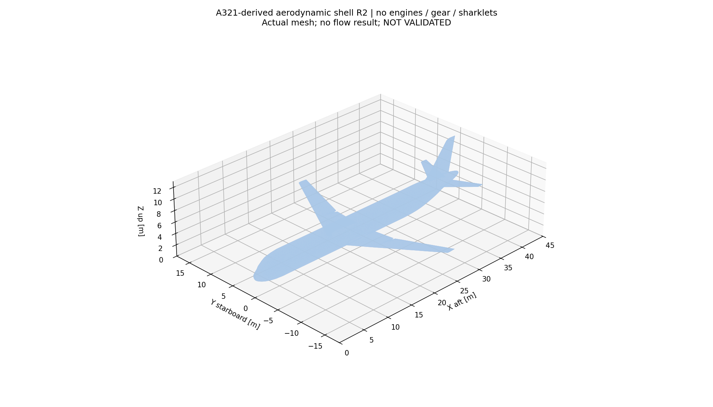
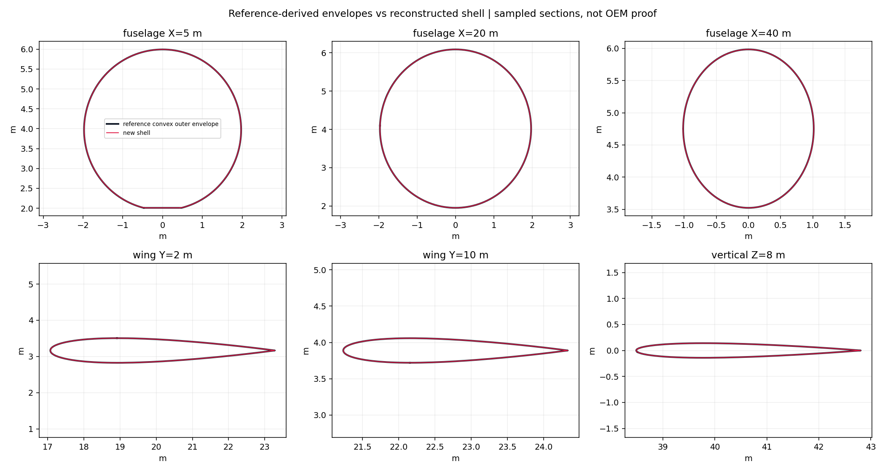

# A321 기반 공력 전용 외피 R2 — GPU 실행 전 준비 결과

2026-11-05. **형상 생성 DONE / CPU 격자 생성 DONE / 공력용 격자 수용 FIX_FIRST / 유동 계산 NOT_RUN.**

기존의 조각 많은 시각화 모델을 그대로 닫는 대신, 원본에서 단면을 측정해 동체·날개·미익 외피를 새로 구성했다. Blender 5.2.2 LTS CLI로 별도 `.blend`를 작성하고 새 프로세스에서 재열기·STL 재출력했다. 같은 파일을 Blender GUI에서도 열어 확인했다. NASA 지침과 결과 문서는 Ego Lite에서 직접 확인했다. **Ego Lite는 웹 제어 도구이며 Blender GUI를 직접 조작하는 도구가 아니다.** Blender는 CLI/bpy 또는 Windows Computer Use로 제어한다.

## 1. 정확한 기준선과 변경 범위

| 항목 | 값 |
|---|---|
| 포크 | https://github.com/Py-CI-Park/Iteration-CFD (공개 포크) |
| 브랜치 | `codex/a321-aero-shell-20261105` |
| 출발점 | `1769b06e0b7a9ec46eaa5823d74532ca87a9de1f` (이전 CPU 진단 연구 포함) |
| 원본 | Aircraft-Workbench `A321_NATIVE_G1B_LOCAL_NORMAL_ENCODING_RESEARCH.blend` |
| 원본 SHA256 | `1fd3cfd08b1dbf5e5f2fb288caf9846ad149ff8839a37cc2e4c2c8074bc1073c` |
| 원본 크기 | 38,570,017 bytes |
| 좌표/단위 | native X 기수→꼬리, Y 우현+, Z 위, m |
| 원본 판정 | `RESEARCH_HOLD` 유지; OEM 일치성/CFD validation 미확인 |
| 새 모델 | **A321-derived symmetric airframe shell R2** |
| 생략 | 엔진·파일런·기어·샤클렛·창/문·내부·개별 flap/slat 틈 |
| 대칭 가정 | 우현 주익·수평미익을 좌현으로 미러, 동체 좌우 대칭 외곽 |

원본은 읽기만 했다. 원본의 같은 SHA인 frozen 사본에서 `export_reference.py`를 실행했다. 각 그룹의 선택 객체 이름·삼각형·범위를 `evidence/baseline.json`에 남겼다. 기존 실패 복셀 표면은 기준으로 사용하지 않았다. Aircraft-Workbench의 default/registry/성숙도/설치본을 변경하지 않았다.

현재 형상은 OEM A321의 clean configuration이라고 승인된 모델이 아니다. 장치 틈을 convex section envelope로 통합하고 좌우 대칭을 가정한 **별도 연구 형상**이다. 샤클렛을 생략해 날개폭은 약 **32.58m**이며 원본의 샤클렛 포함 35.80m와 다르다. 생략을 숨기려고 전체를 35.80m로 재확대하지 않았다.

원본 폭의 근거는 `evidence/sharklet-span.json`이다. 같은 SHA native의 저장된 객체 inventory에서 `Sharklet_PORT/STARBOARD`의 world Y min/max를 읽어 35.799999m를 확인했다. 이는 연구 모델의 치수이지 OEM 형상 일치성 판정이 아니다.

## 2. 무엇을 만들었는가

1. 원 native에서 동체 Crown/Belly, 우현 주익 외형 11객체, 우현 수평미익 2객체, 수직미익 2객체를 정확 world 좌표로 추출했다.
2. 평면과 실제 삼각형의 교차점을 구하고 단면별 convex outer envelope를 구성했다. 동체는 radial sampling, 얇은 날개·미익은 cosine chord sampling을 사용했다. 이 방식은 틈·오목한 부분을 메우는 연구용 단순화다.
3. 단면 사이를 직선 loft하고 끝단을 막아 부품별 closed solid를 만들었다. 기수·꼬리 끝은 1mm 안쪽 단면과 작은 끝 ring을 사용하는 별도 끝단 근사다.
4. 좌우를 대칭화하고 CPU Manifold Boolean union으로 동체·주익·미익을 하나의 외피로 합쳤다.
5. Blender 안에 부품 loft와 최종 외피를 작성했다. 참고 loft 컬렉션은 숨겨두고 최종 외피만 내보냈다. `.blend`와 STL을 저장하고 별도 Blender 프로세스에서 재열기했다.

원형 부품을 전부 정리한 파일이 아니라 **측정한 단면을 사용한 새 메시**다. 따라서 창/문·접합부 세부 곡률·fairing·고양력장치·실제 제작 단면의 손실이 있다. convex envelope 정확도와 공력 정확도는 별도 검토 대상이다.

## 3. 실제 검사 결과

| 검사 | R2 결과 | 의미 |
|---|---:|---|
| 삼각형 / 정점 | 129,532 / 64,768 | 최종 Boolean union 메시 |
| 열린 변·비다양체 변·방향 불일치 | 모두 0 | exact STL coordinate 기반 변 검사 |
| 퇴화면·중복면 | 모두 0 | 면 검사 |
| 정점 link 실패 | 0 | 각 정점 이웃이 단일 cycle인지 검사 |
| 연결 성분 / Euler 수 | 1 / 2 | 현재 폐합된 한 표면 |
| Manifold kernel 상태 | `NoError` | CPU Boolean 및 재입력 유효성 |
| 젖은 표면적 | 798.054168 m² | CL/CD 기준 면적과 다름 |
| 닫힌 체적 | 504.661352 m³ | 새 단순화 형상의 체적 |
| Blender 저장·재열기 STL | SHA 일치 | export와 reopened가 바이트 동일 |
| 비교 18단면의 범위 최대 차이 | 약 1.37mm | 선택 단면의 min/max 비교이며 전체 Hausdorff 거리 아님 |
| 독립 모든 삼각형 쌍 자기교차 검사 | 미실행 | kernel 성공으로 대체 완료라고 주장하지 않음 |

기하학적으로 더 명확한 후보를 만들었지만 **공력적으로 검증된 A321 모델은 아니다.** 전체 표면의 연속 거리·단면 곡률·앞전 반경·뒷전 두께·비틀림 오차·접합부 유동 영향은 아직 별도 검토가 필요하다.

R1은 radial sampling이 얇은 날개 시위 끝을 충분히 포착하지 못해 Y=2m에서 범위 차이 약 0.298m가 있었다. R2는 chord sampling과 검토 station 추가로 수정했다. 비교 station이 생성 station에 포함된 경우가 있으므로 이 값은 독립 holdout 정확도 시험이 아니다. 18단면 외의 구간과 loft 사이 곡률은 미측정이다. R1과 실패 기록을 보존한다.

추가로 각 부품에서 **생성 station 사이 중간 위치 12개씩, 총 48개 holdout 단면**을 검사했다(`evidence/holdout.json`). 외곽 범위 최대 차이는 동체 11.01mm, 주익 0.362mm, 수평미익 0.204mm, 수직미익 25.11mm다. 끝단 cap에서 두 구간 떨어진 내부 station만 표본 검사했다. 단면 형상 전체·곡률·끝단·접합부·실기 일치성의 전수 보증이 아니며, 기체 근사에 적합한 공력 허용오차는 아직 설정·수용하지 않았다. 부품별 양방향 정점→삼각형 거리 표본도 같은 JSON에 보존했다.

표면 거리 표본 최대값은 원본→새 동체 86mm, 새 동체→원본 810mm, 원본→새 주익 157mm다. 끝단 근사·오목부 제거·개구 폐합·내부 return 등이 후보 원인이지만 위치별 원인 분류는 미완료다. 단면 범위의 작은 차이로 이 국소 형상 변경을 숨기지 않으며, 전체 기하 충실도는 HOLD다.

## 4. CPU 체적 격자는 어디까지 됐는가

Gmsh 4.15.2 첫 경로는 PLC segment/facet 교차 오류, 재분할 경로는 작은 패치 반복에 막혀 중단했다. 원인을 확정하지 않았고 두 실패를 동일 원인으로 합치지 않았다. `meshing-investigation.md`, `evidence/meshing-attempts.json`에 로그 요약·SHA를 보존했다. 실패한 Gmsh 로그의 거대한 반복 출력은 Git에 넣지 않았다.

독립 **MeshPy/TetGen CPU** 경로는 R2 STL을 원래 삼각형 그대로 사용해 외부 직육면체 안의 기체 내부를 hole seed로 제외했다. 사면체 생성 후 VTK 출력 선택 의존성 `pyvtk` 부재로 스크립트가 중단됐으나, 이미 저장된 `fluid.npz`를 `mesh_readback.py`로 읽어 격자를 재계산하지 않고 VTK·독립 품질·경계 분류를 완료했다.

| 격자 검사 | 실제 결과 |
|---|---:|
| 셀 / 점 | 793,977 / 154,758 |
| 양수가 아닌 셀 | 0 |
| 가장 작은 셀 체적 | 5.7449e-13 m³ |
| 유체 연결 성분 | 1 |
| 셀 면 3개 이상 공유 | 0 |
| 전체 체적 / 예상 체적 | 2,339,495.338648416 m³ / 동일 값 (상대차 약 2e-16) |
| mean ratio 최솟값 / 하위1% | 2.318e-7 / 0.03560 |
| mean ratio <0.01 셀 | 4,797 |
| 기체 벽면 삼각형 | 129,532 |
| 바깥 각 면 삼각형 | 각 2개 — 과도하게 거친 경계 |
| 프리즘 경계층 | 0 |

**격자는 생성됐으나 공력용 격자로 불합격(FIX_FIRST)**이다. 양 체적·전체 체적 일치만으로 sliver·경계층·경계 해상도 문제를 해결했다고 할 수 없다. 현재 격자를 GPU solver에 넣지 않는다. `artifacts/meshpy-r1/fluid.npz`, `fluid.vtk`, `boundary.npz`는 로컬 진단용으로 보존한다. Iteration-CFD의 독립 mesh gate·polyMesh 변환·실제 solver loader는 아직 실행하지 않았다.

## 5. GPU 직전까지의 준비와 다음 실행 관문

`evidence/case-plan.json`은 **계획**이다. 30m/s·288.15K·ρ=1.225·ν=1.46e-5·α=2°·β=0°를 제안했다. 바람 벡터는 `(29.981725,0,1.046985)m/s`이며 양력/항력 축을 명시했다. 원점과 기준축은 native를 유지한다.

현재 단면을 적분한 이 연구의 기준 면적은 **122.788916m²**, 평균 공력 시위는 **4.299175m**다. 이 면적은 뿌리까지 포함한 미러 주익 convex planform이므로 **공식 A321 면적이라고 쓰지 않는다.** 미래 CL/CD도 이 별도 기준 면적을 이름 붙여 사용해야 한다.

평판 마찰 상관식으로 계산한 y+=1의 첫 셀 중심 거리는 약 **12.4µm**, 첫 층 두께 추정은 약 **24.9µm**다. 이는 선행 추정이며 실제 해의 y+가 아니다. 전체 크기의 기체를 벽면까지 해상하는 격자는 자원 비용이 크므로, 경계층 해상 전략 또는 벽함수 전략을 명시적으로 선택해야 한다. 목표 y+만 바꿔 이번 sliver 격자를 통과 처리하지 않는다.

| 단계 | 상태 | 다음 행동 |
|---|---|---|
| A0 원본 고정 | DONE | source SHA 유지 |
| A1 외피 설계 | DONE | 단순화·대칭 가정 유지 |
| A2 Blender 외피 생성 | DONE R2 | 후보 형상 세부 검토 |
| A3 폐합·정점·왕복 검사 | 제한 PASS | independent intersection·holdout section 검토 잔여 |
| A4 조건·기준량 계획 | DONE PLAN | 유입 난류량·압력·면적·벽처리 최종 잠금 |
| A5 CPU 격자 | 생성 DONE / 수용 FIX_FIRST | sliver 제거·외부 경계 세분화·경계층 가능 경로 마련 |
| GPU 실행 직전 관문 | **STOP** | 독립 mesh gate·solver 설치/로딩 검증 후 별도 실행 결정 |

후속은 ① 형상 holdout/접합 검토 → ② prism/layer-capable CPU 격자 → ③ 품질/폐합/보존 게이트 → ④ 경계조건·난류·벽처리 → ⑤ GPU probe/소형 기준해 → ⑥ 본계산 → ⑦ 잔차·질량·힘 안정성 → ⑧ 3수준 격자·영역·시간 민감도 → ⑨ 동일조건 실험 비교 순서다. 이번에는 GPU probe·CUDA context·solver·validation suite·Blender GPU render를 호출하지 않았다. 창 표시와 웹 브라우저의 일반 그래픽 사용까지 0이라는 뜻은 아니다.

## 6. 파일·실행·출처

- **모델:** `models/A321_AIRFRAME_SHELL_R2.blend`, `.stl` (공개 포크에 올릴 새 파생 형상). 원본 native는 업로드하지 않는다.
- **근거:** baseline/reconstruction-r2/shell-audit-r2/native-readback-r2/cpu-mesh-readback/case-plan/artifact-manifest JSON.
- **코드:** `export_reference.py → reconstruct.py → blender_shell.py → reopen_shell.py → audit_shell.py → meshpy_trial.py → mesh_readback.py → plan_case.py`.
- **재실행:** `RUNBOOK_KO.md`. 기존 결과는 덮어쓰지 말고 새 연구 개정 디렉터리를 사용한다.
- **NASA:** [절차](https://www.grc.nasa.gov/www/wind/valid/tutorial/process.html), [V&V](https://www.grc.nasa.gov/www/wind/valid/tutorial/tutorial.html). Ego Lite에서 2026-11-05 재확인, `evidence/nasa-browser-20261105.json`에 보존. 분석 단계를 체계화하기 위한 출처이며 이 모델/코드에 대한 NASA 승인이 아니다.
- **도구 문서:** [Manifold](https://manifoldcad.org/docs/html/classmanifold_1_1_manifold.html), [Gmsh](https://gmsh.info/doc/texinfo/gmsh.html). 독립 프로그램/API로 사용했고 솔버 수치 구현은 변경하지 않았다.

포크 이슈 기능이 비활성이라 연구 작업서와 커밋을 사용한다. push는 사용자가 명시 승인한 이 연구 브랜치에만 수행하며 main 병합·태그·릴리스는 수행하지 않는다. 이전 CPU preflight 이력도 같은 브랜치 조상에 포함된다.
